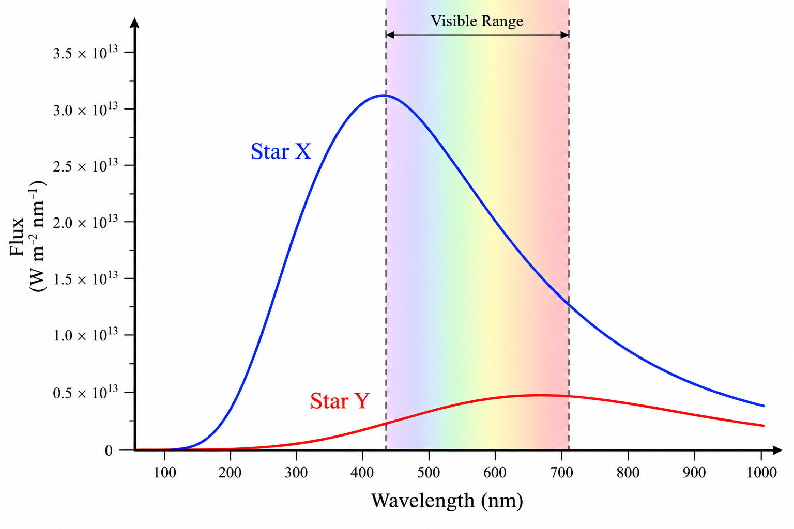
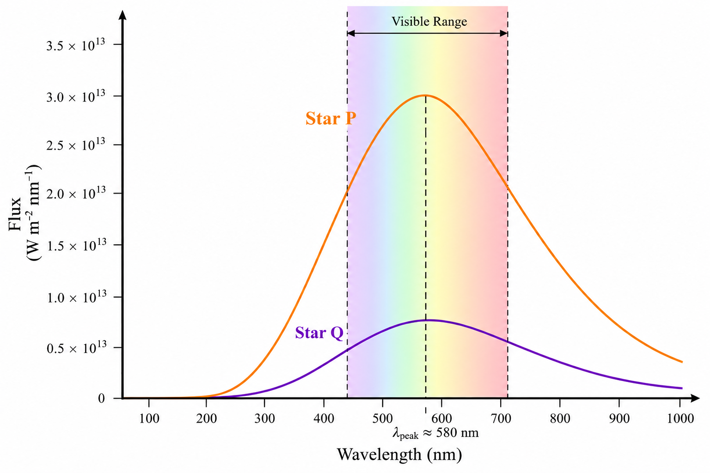
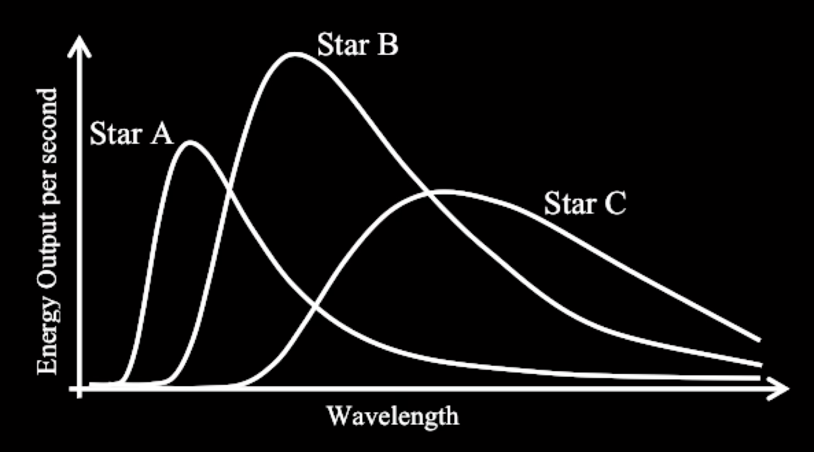
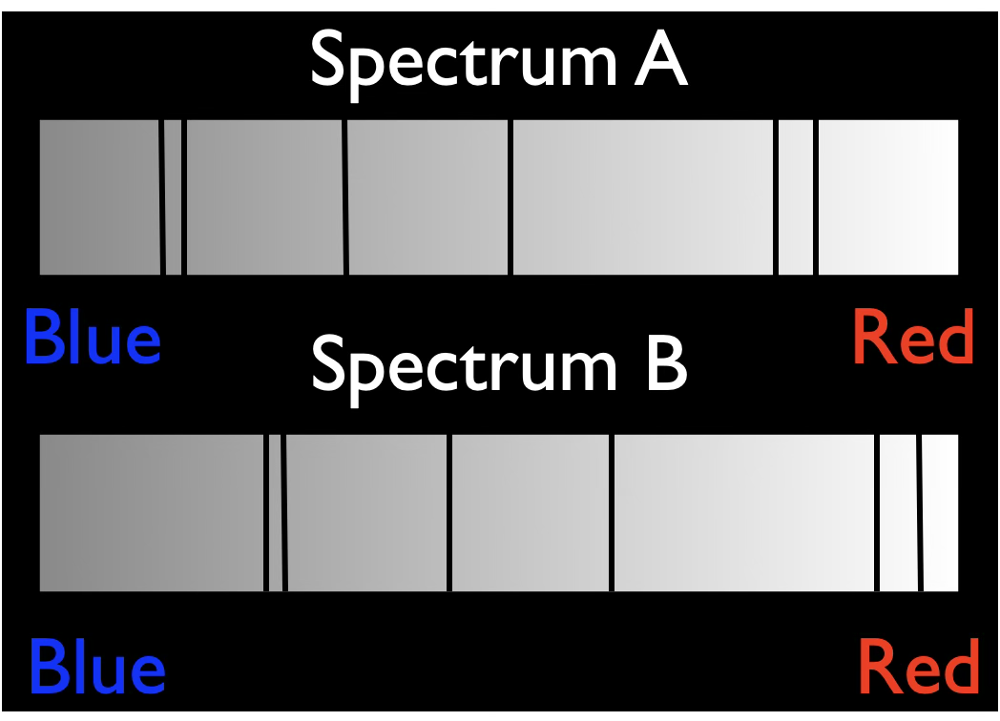

## Lecture Tutorial: Black Body Radiation

### Check your understanding

<quiz>
Compare Star X and Star Y. Which gives off more red light?

- [x] Star X
- [] Star Y
- [] Both stars give off the same amount of red light

</quiz>

<quiz>
Which best describes how Star X and Star Y appear?

- [] Both stars would appear more red than blue
- [] Both stars would appear more blue than red
- [] Star X would appear more red and Star Y more blue
- [x] Star Y would appear more red and Star X more blue

</quiz>

<quiz>
Which of the two stars P and Q has a higher temperature?

- []  Star P
- []  Star Q
- [x]  They have the same temperature
- []  Cannot tell from this graph

</quiz>

<quiz>
Which of the two stars P and Q is larger?

- [x]  Star P
- []  Star Q
- []  They have the same temperature
- []  Cannot tell from this graph

</quiz>

<quiz>
Which star (A, B, or C) is the biggest?

- []  Star A
- []  Star B
- [x]  Star C
- []  Cannot tell from this graph

Remember: A hotter star with the same size gives off more light at every wavelength.

Star C is cooler. But it gives off more red light than either star B or star A. So it must be bigger than both those stars. 

</quiz>

## Doppler Shift

### Check your understanding

<quiz>
The solar system moves towards a star cluster containing a red star, a blue star, and a yellow star.  The red star is closest, and the blue star is is farthest away.  Which star is blueshifted?

- [] The red star.
- [] The blue star.
- [] The yellow star.
- [x] All the three stars.
- [] None of the three stars.

</quiz>

<quiz>
You observe two spectra (shown above) that are both <b>blueshifted</b> relative to that of a stationary source of light.   

Which of the following statements best describes the <b>radial</b> motion of the sources of light?

- [x] Star A is moving faster than Star B.

- [] Star B is moving faster than Star A.

- [] Both stars are moving with the same speed.

- [] It is impossible to tell from looking at these spectra.

</quiz>

<quiz>
An important line in the absorption spectrum of hydrogen occurs at a wavelength of 656nm when at rest. 

Imagine that you observe four stars (ABCD) and measure this absorption line at the following wavelengths:

| Option | Wavelength |
|--------|------------|
| A | 649 nm |
| B | 660 nm |
| C | 656 nm |
| D | 658 nm |

Rank the speed of the stars from moving fastest toward you to moving fastest away from you:

- [x] B,D,C,A
- [] D,C,B,A
- [] C,A,D,B
- [] A,C,D,B

</quiz>

<quiz>
A spacecraft is moving away from two asteroids that are at rest relative to each other. It measures the spectrum of sunlight reflecting off each asteroid. How do their redshifts compare?

- [] They both have zero redshifts

- [] The closer asteroid has a greater redshift

- [] The farther asteroid has a greater redshift

- [x] They both have the same redshifts

</quiz>

