# Astronomical spectra

## Emission spectra

“Fingerprint” of composition, 
emitted by energized gas

Only a few specific wavelengths of light are present in an emission spectrum from an energized gas

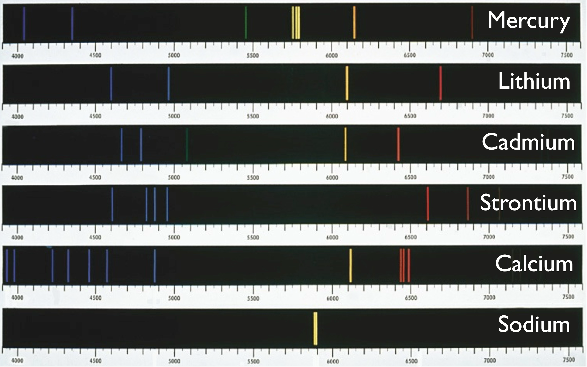

## Emission spectra of the elements

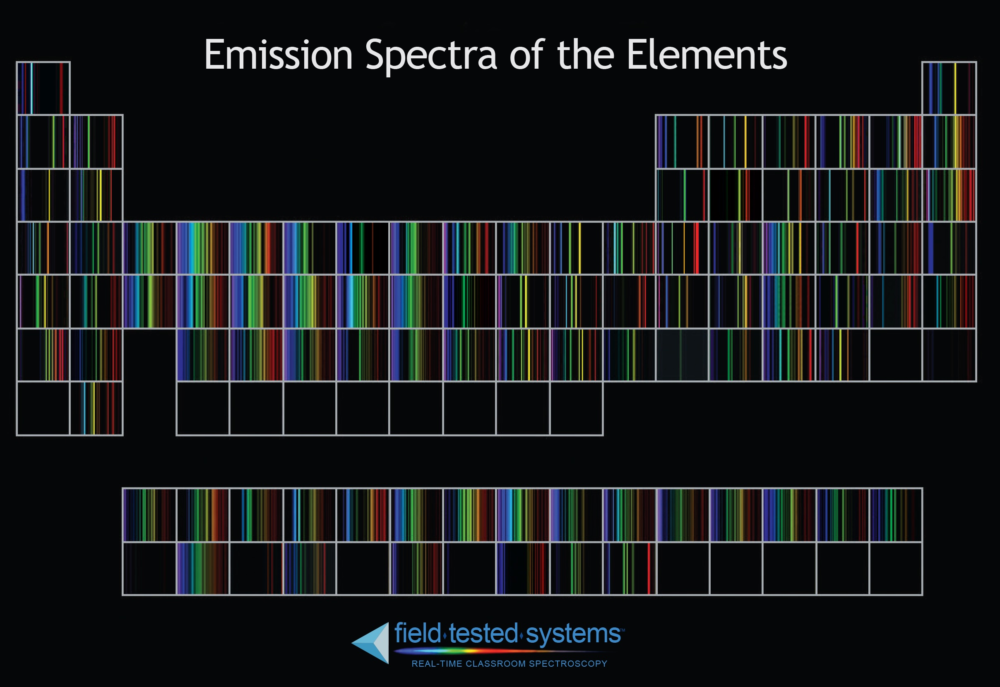

## Element discovery!

The element Helium was first discovered from an emission line spectrum of the Sun’s atmosphere (observed during an eclipse)

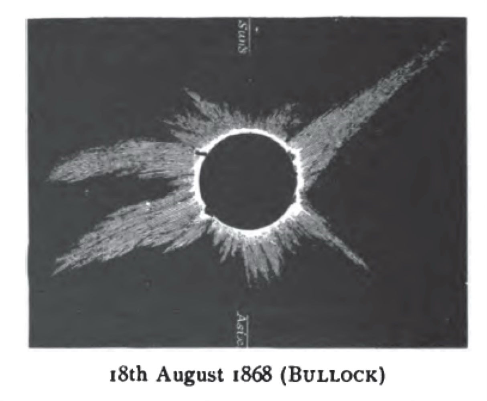

The bright yellow line didn't match any known elements.

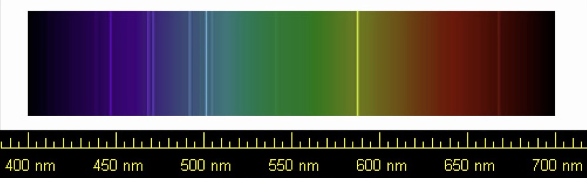

## Hydrogen alpha

Long exposure filtering for only hydrogen-red reveals 
faintly glowing clouds of hydrogen gas among the stars

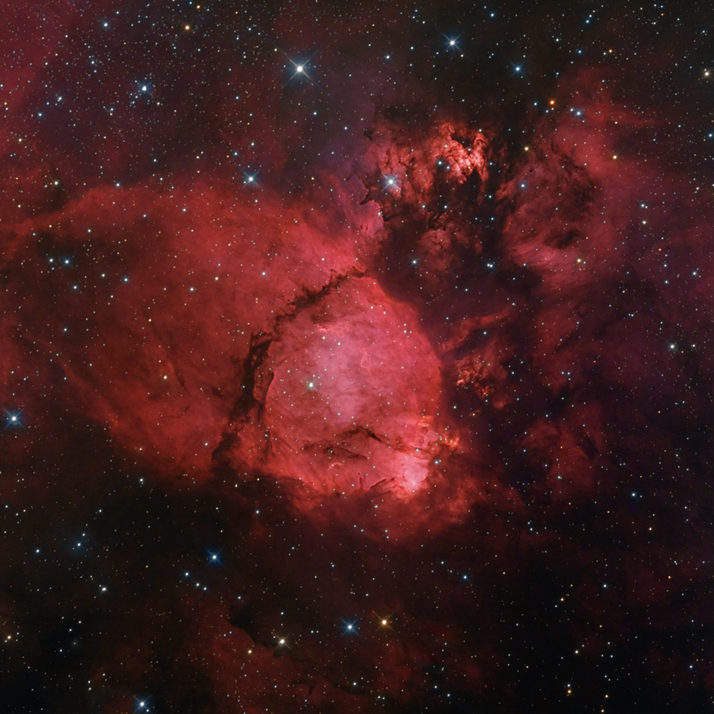

## Continuous Spectrum

A hot, dense source produces light at many wavelengths

Heat energy moves electrons to higher energy levels
Dense matter has many possible energy levels 

(complicated atomic structures, interactions between atoms, free electrons have escaped a single atom)

Hot dense matter produces light in a wide range of wavelengths instead of just a few lines

## Continous astronomical sources

The hot dense cores of stars produce continuous spectra

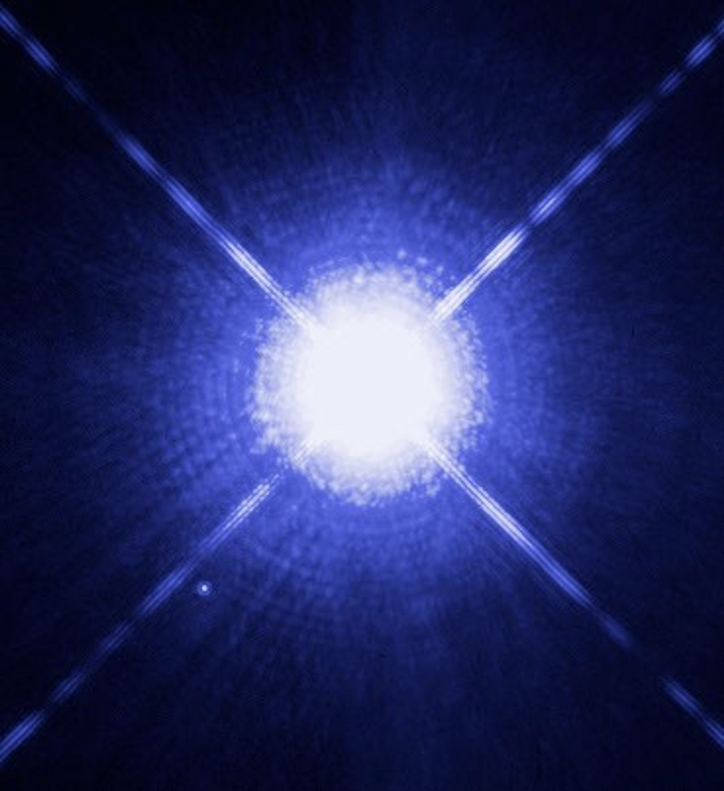

Matter falling into black holes produces continuous spectra

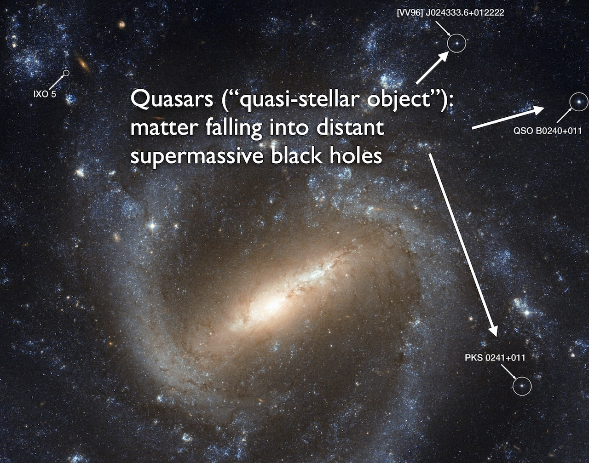

## Absorption

Astronomers use distant hot dense sources to measure the composition of gas in space

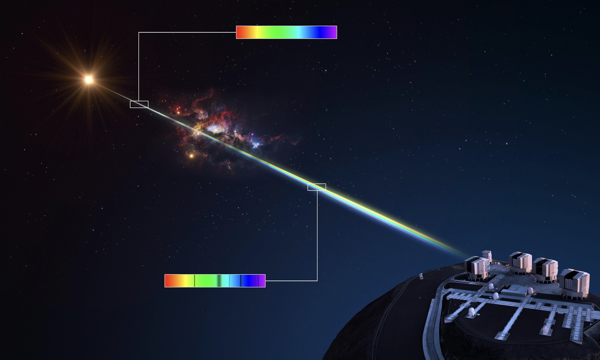

Spectra can be measured from extremely distant objects

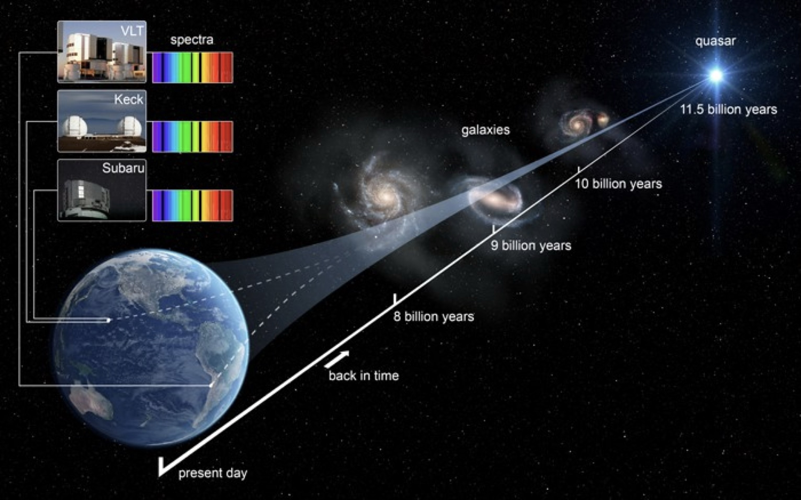

Note: all stars produce absorption spectra because they have lower-density outer layers

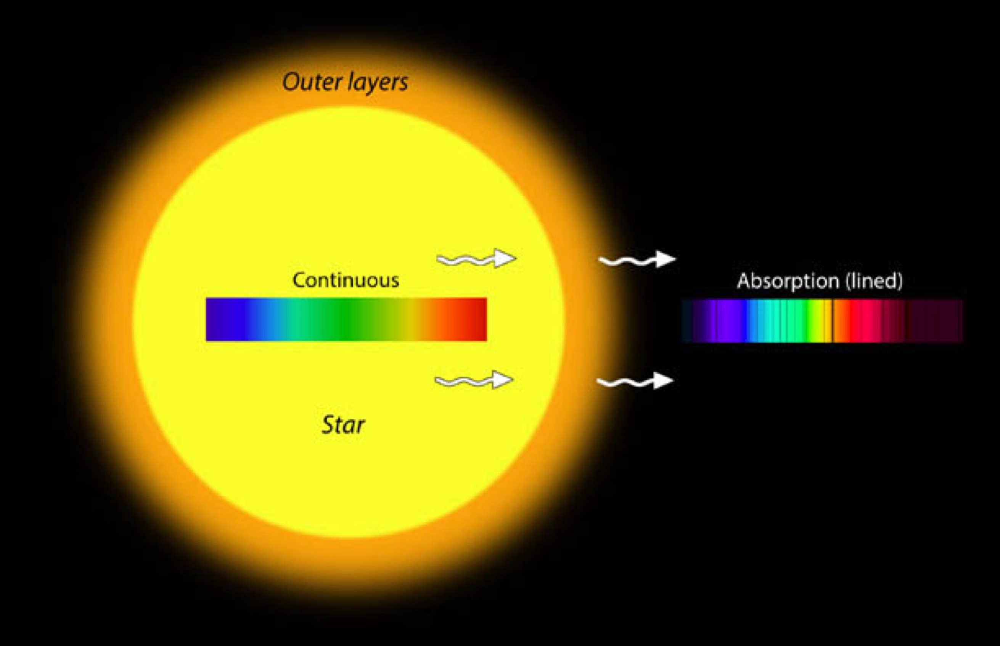

Absorption lines can be recorded even for dim stars

Astronomers first categorized stars by the number of absorption lines

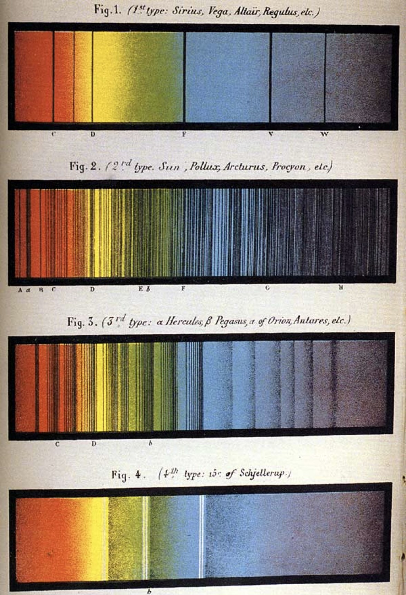

Annie Jump Cannon (1863-1941) and Antonia Maury (1866-1952) analyzed astronomical data.

They realized that the spectral classes of stars could be ordered based on temperature

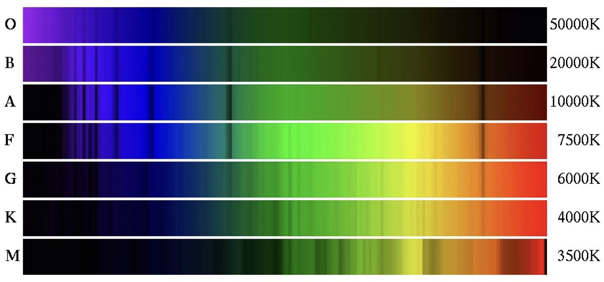

How did they know temperature? Compare the energy (wavelengths) of the light the stars emit!

## Check your understanding

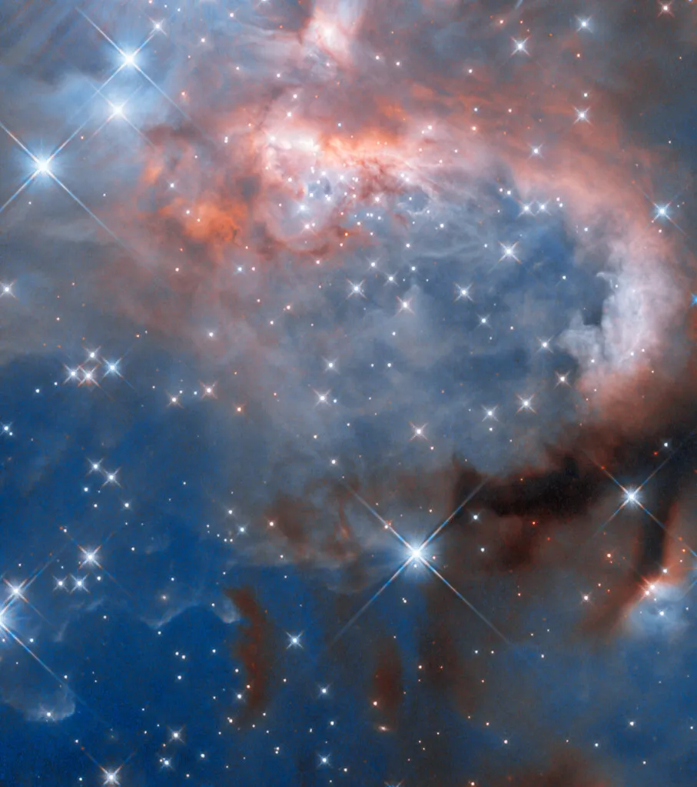
What type of spectrum would you see...

<quiz>
Viewing a star inside a nebula of gas and dust?

- [] Continuous
- [x] Absorption
- [] Emission
</quiz>

<quiz>
Viewing the interstellar gas of the nebula itself?

- [] Continuous
- [] Absorption
- [x] Emission
</quiz>

<quiz>
Which elements are present in the atmosphere of the star with the spectrum seen above?

- [] Q only
- [] R only
- [] Q and R
- [] R and S
- [x] Q and S
</quiz>
