# Star Color and Luminosity

- Thermal spectra
- Temperature and color
- Luminosity, temperature, and size
- Main Sequence and Giant stars

## Thermal Radiation

Patterns in the continuous spectra from hot dense sources:

The energy of a photon determines its frequency and wavelength.

When we look at the wavelengths of all the photons from dense materials, we notice a pattern.

The pattern depends on temperature

## Explaining Thermal Spectra 
A photon is emitted from an electron transition inside a hot metal poker

The energy bounces around inside the poker being absorbed and re-emitted from complicated levels

When photons finally escape from the poker, they have a random energy

Hotter metal means higher average energy: 

 Most photons will have 
 
shorter wavelengths

## Temperature in Kelvin

We measure temperature in Kelvin to connect to energy (like Celsius, but shifted)

- 0 K = -273° C (“Absolute Zero” - average kinetic energy of particles is zero)
- 300 K = 27° C (warm day)
- 373 K = 100° C (boiling)

Stars have temperatures of thousands of Kelvin.

## Plotting Spectra

Plotting spectra: intensity vs frequency/wavelength

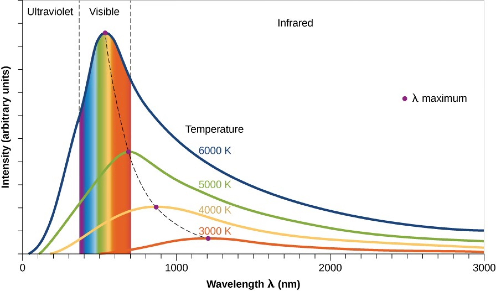

## Thermal Spectra and Color

A hot dense object produces a continuous spectrum of light

A hotter object emits light with higher (average) energy

➡︎ Peak wavelength is shorter ➡︎ More blue in color

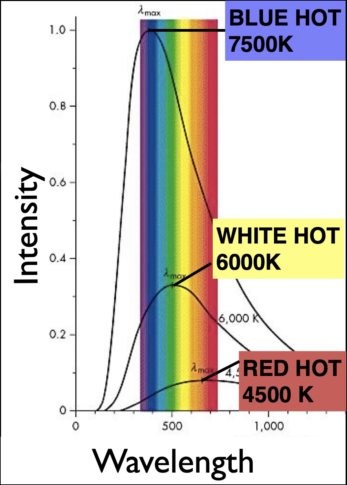

A balance of all colors of visible light looks white

An object emitting mostly red light looks red

An object emitting mostly blue light looks blue

## Beyond visible light

(Scale changed to show a wider range in intensity)

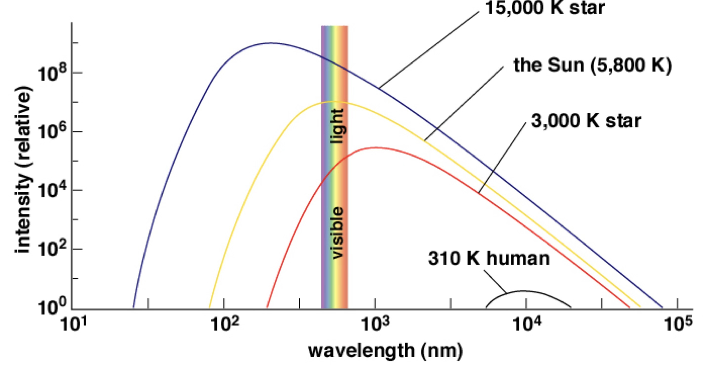

Hot stars emit ultraviolet

All stars emit infrared.

 What light does a human emit at human temperatures?

Infrared!

## Heating a nail

See the [Melted Nail Demonstration](https://astro.unl.edu/classaction/animations/light/meltednail.html)

## Terminology notes

- Scientists call something that emits a thermal spectrum a “blackbody”
  - Something that absorbs and emits all colors of visible light 
  - Would appear black (like your pupil).
- A blackbody emits an *ideal thermal spectrum* that depends only on temperature

## Temperature of the Sun

Comparing the Sun to a blackbody spectrum confirms that the surface temperature of the sun is about 5,000-6,000K.

## Thermal Spectra of Stars

The colourful star cluster NGC 3532. Some of the stars still shine with a hot bluish colour, but many of the more massive ones have become red giants and glow with a rich orange hue.

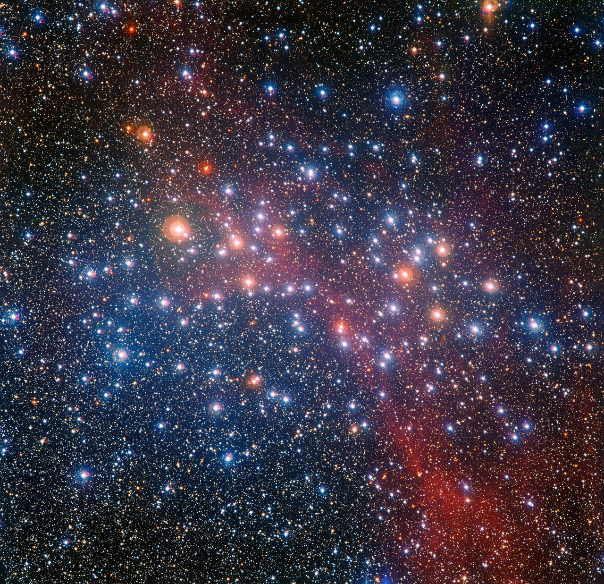 *Source[ESO/G. Beccari](https://www.eso.org/public/images/eso1439a/*)

Star color:

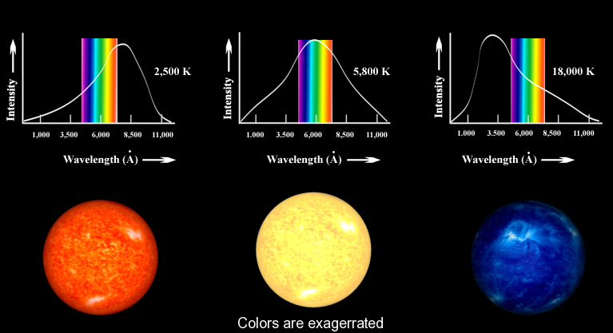

### Real examples

Betelgeuse looks reddish. It gives off more red light than other colors. It has a surface temperature of about 3,500 K.

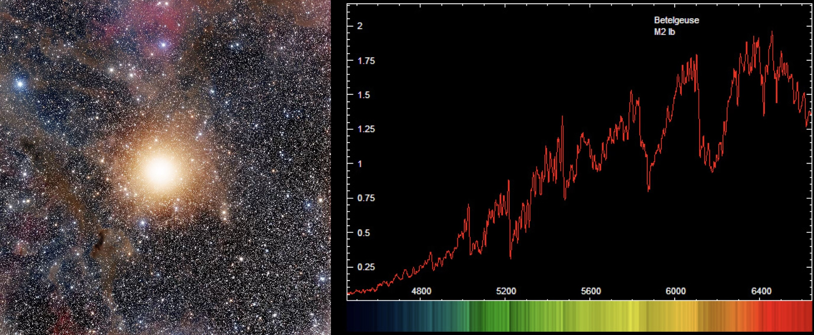

O Alnitak looks blueish. It gives off more blue light than other colors, and gives of ultraviolet light. It has a surface temperature of around 29,000 K.
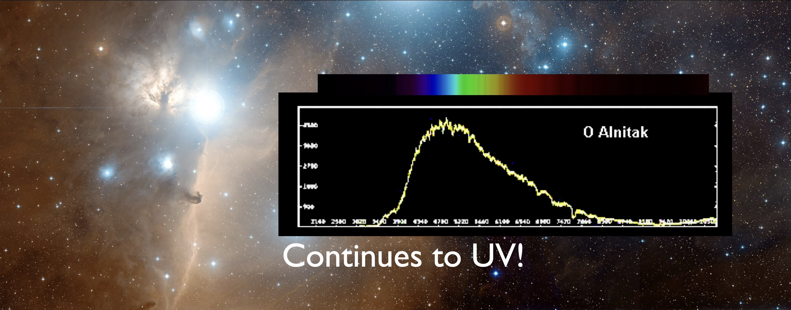

## Luminosity

A star’s luminosity is the total amount of energy that star emits as light 

- Add up light intensity from all wavelengths
- Add up light from the full star surface

### Main sequence stars have different sizes

Most stars are main sequence

Hotter main sequence stars are also bigger

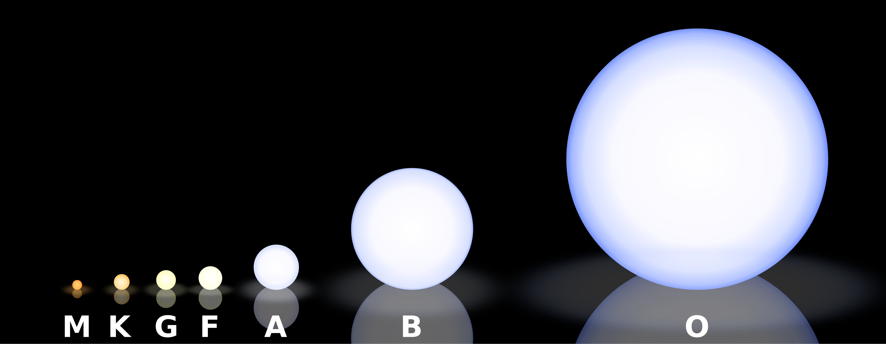

## Luminosity, Temperature, Size

A star’s total energy output (luminosity) depends on both temperature ($T$) and size (radius $R$)

Energy per square meter $\sim T^4$

Number of square meters $\sim R^2$

(The surface area of a sphere is $4 \pi R^2$.)

A star’s total energy output (luminosity) depends on both temperature and size

$L \propto T^4 R^2$ 

The greater a star’s size, the more surface area there is to emit light

The greater a star’s surface temperature, the more light it will emit from each bit of surface

## Solar Luminosity 

We use Sun’s energy output or luminosity as a reference value: $L_{\text{Sun}}$

Stars come in a wide range of luminosities, from 0.00001 $L_{\text{Sun}}$ to 1,000,000 $L_{\text{Sun}}$ 

Dim stars are much more common than bright stars 

Our Sun is in the middle of the luminosity range, but it outputs more energy than a vast majority of the stars in our galaxy.

## Habitable Zone for different stars

Luminosity determines the habitable zone of main sequence stars

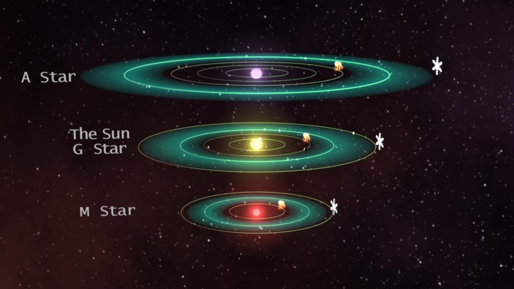

## Giant Stars

Some stars are huge!

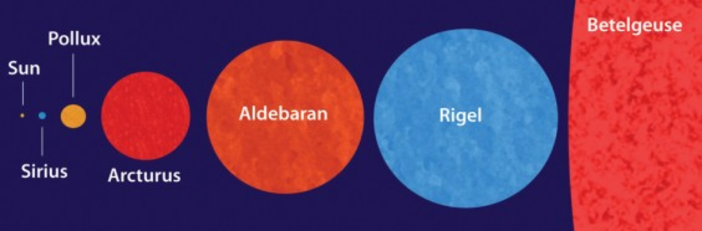

The Sun is much hotter than the red supergiant Betelgeuse

Which star puts out the most energy?

Betelgeuse is so large that it was the first star to be actually imaged in the sky:

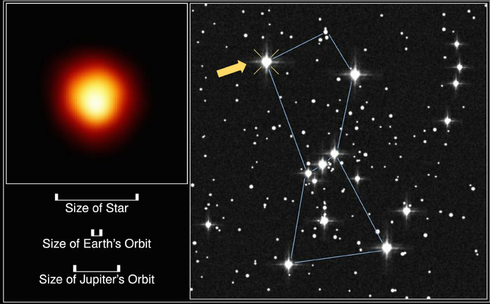 *Source [Andrea Dupree (Harvard-Smithsonian CfA), Ronald Gilliland (STScI), NASA and ESA
](https://science.nasa.gov/image-detail/betelgeuse-location-and-size/)*

Red Giant star Betelgeuse: cool but luminous

Betelgeuse's luminosity is 100,000-times that of the Sun.

## Check your understanding

These are the specta of different main sequence stars:

<quiz>

Which of these main sequence stars  would look most blue?

- [x]   B Star
- []   F Star
- []   K Star

</quiz>

<quiz>

Which of these main sequence stars  would look most red?

- []   O Star
- []   G Star
- [x]   M Star

</quiz>

<quiz>

Which has the highest temperature?
- [] The lava
- [x] The light bulb filament

</quiz>

<quiz>
Which star has the highest temperature?

- [] Star A
- [x] Star B
- [] Star C

</quiz>

