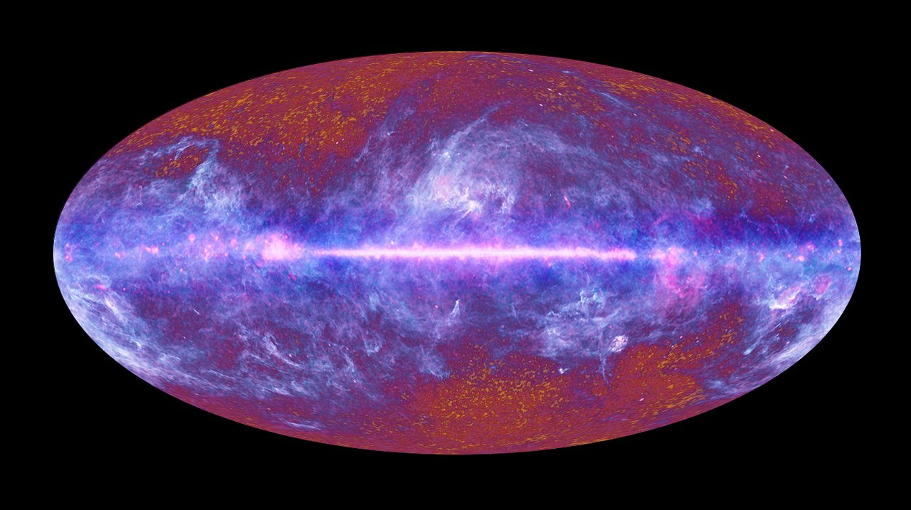
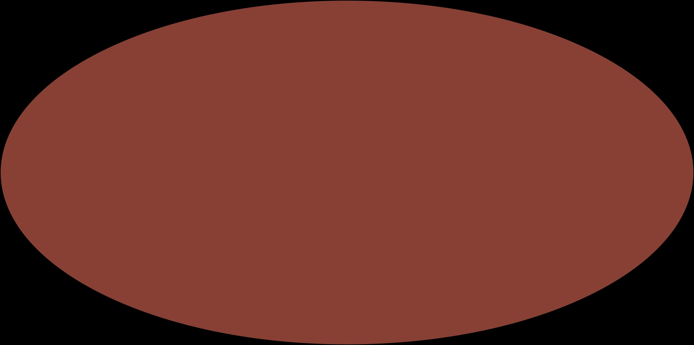
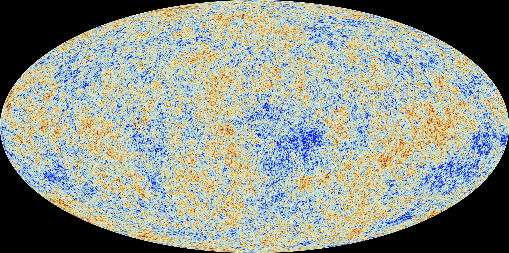
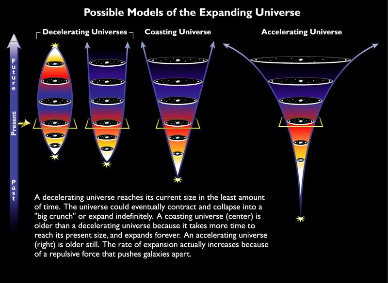

# Universe Past and Future

- Olber’s Paradox 
- The Cosmic Microwave Background
- The Future Universe
- Dark Matter and Dark Energy

## Olbers’ Paradox
Wilhelm Olbers (1758–1840)

- Could the universe we see be inifinite, i.e. extend the same way forever in time and space?
- If you looked far enough, you would eventually see a galaxy or star
- The light from the star has infinite time to reach you
- If the universe is infinite and unchanging, the entire night sky should be bright.

### Possible explanations for the “paradox”?

- The universe has a finite amount of stars
- Dust and gas obscures light
- The universe is young so distant light hasn’t reached us yet
- The universe is expanding, so light from far away stars is redshifted so much we can’t see it

### Modern perspective on Olbers’ Paradox: 

Light travels at a constant speed

It takes time for light to travel

If you look far enough, we see the beginning of the universe

## Cosmic Microwave Background

In 1965,  physicists measured a background of microwave radiation, from everywhere in the sky. 

It is a thermal spectrum from a source at 2.7 K 

### Interpreting thermal spectra
Wavelengths of light stretch with the expansion of the Universe. What happens to the apparent temperature of a thermal radiation spectrum that expands with the Universe?

It looks... 

cooler

## The sky (microwaves)

- Gas and Dust in the Galaxy (pink/blue)
-  Uniform background glow from earlyuniverse (orange/red)

*Source: [ESA, LFI & HFI Consortia](https://www.esa.int/media/the-microwave-sky-as-seen-by-planck)*

Subtracting out known sources like our galaxy,
there is a uniform glow from every direction

 Tiny fluctuations in the microwave background radiation tell us about the early universe. This next skymap shows small changes of the mostly-uniform glow across the sky.

*Source: [ESA and the Planck Collaboration](https://www.esa.int/ESA_Multimedia/Images/2013/03/Planck_CMB)*

## Big Bang Cosmology

 The universe began with the Big Bang: a hot, dense “object” everywhere in space

 Space began to expand and cool
 
 After 380,000 years, it cooled to 3000 K, became transparent, and released a 3000 K continuous spectrum everywhere in all directions
 
 As the universe expanded, this light was Doppler shifted to longer wavelengths
 
 Today, we observe a thermal spectrum of microwaves from all directions with a 2.7K temperature

 ## Learning from CMBR

*Source: [NASA/WMAP Science Team](https://commons.wikimedia.org/wiki/File:CMB_Timeline75.jpg)*

The pattern of the CMBR helps understand the history of the universe expansion.

## Future of the Universe

We measure expansion out to the early universe

The expansion rate can change over the history of the universe.

*Source: [NASA, ESA, and STScI](https://science.nasa.gov/asset/hubble/possible-models-of-the-expanding-universe/)*

It turns out that we are in an accelerating universe. The expansion rate was slower in the past than it is today!

## Contents of the universe

From the way the universe has expanded, we determine what it contains and how much:

5% Visible Matter:
Galaxies, Stars, Gas. and Dust

27% Dark Matter:
Extra mass seen only by its gravitational effects

68% Dark Energy:
Makes expansion accelerate

## Current challenge

*Source: [NOIRLab/NSF/AURA/J. da Silva/J. Pollard](https://noirlab.edu/public/images/noirlab2611b/)*

Current challenge: Different observations disagree on how fast the Universe is expanding. The CMBR gives a different Hubble constant than  supernova observations.

We don't know exactly why! There could be an error in our model of the universe, or in how we analyze the observations.

## Check your understanding

<quiz>
Compared to now, how would you best describe the early universe?

- [ ] Colder and more dense.
- [ ] Colder and less dense.
- [x] Hotter and more dense.
- [ ] Hotter and less dense.

</quiz>

<quiz>
Wavelengths of light stretch with the expansion of the Universe. What happens to the apparent temperature of a thermal radiation spectrum that expands with the Universe?

- [x] Temperature will decrease (it will become cooler)
- [] Temperature will remain the same
- [] Temperature will increase (it will become hotter)

</quiz>

<quiz>
The presence of dark energy in our universe is measured by the change in the expansion rate over time.  Accelerating expansion means that:

- [x]   The expansion rate was slower at early times and faster now
- []   The expansion rate is constant
- []   The expansion rate is faster at early times and slower now

</quiz>

