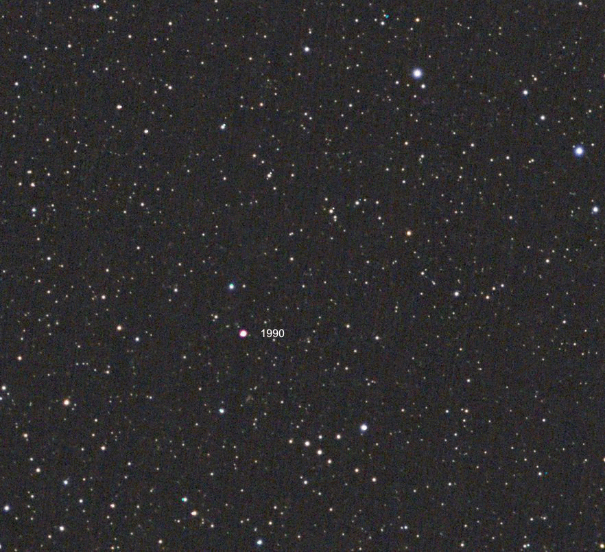
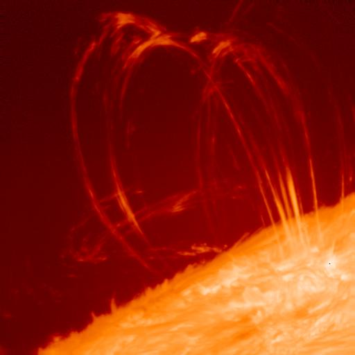
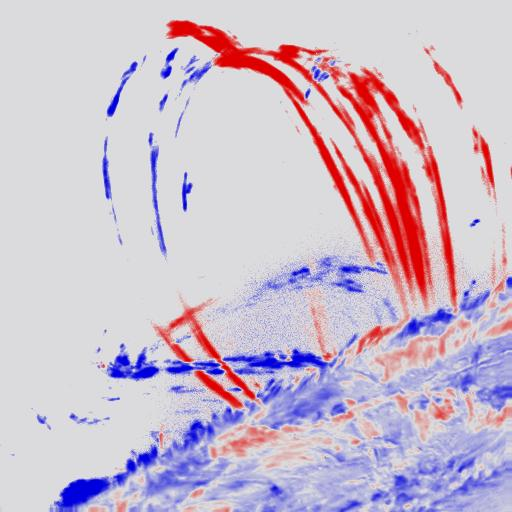
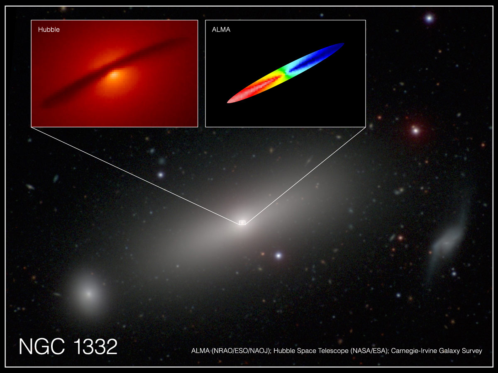

# Doppler Effect

## Motion of stars

 *Source [Mark's Astrophotography](https://mlastro.coffeecup.com/moving-stars.html)*

<figure>
<video controls autoplay loop muted playsinline width="600">
  <source src="../img/uma.mp4" type="video/mp4">
  Your browser does not support HTML5 video.
</video>
  <figcaption>
    The Big Dipper changing shape over time as its stars move through space.
    Source: <a href="https://www.astronomy.ohio-state.edu/pogge.1/Ast162/Movies/proper.html">Richard Pogge, Ohio State University</a>.
  </figcaption>
</figure>

![Diagram illustrating the radial velocity, proper motion, and space velocity of a star. At bottom left is a yellow disk representing the Sun. On the upper right is a smaller orange disk representing a distant star. A dashed, straight line connects the centers of the Sun and the star. (Above, to the left and parallel to this dashed line is a solid line with arrows at each end terminating at what would be the centers of both stars. This line is the total distance, d, separating the Sun and this hypothetical star.) Another dashed, straight line is drawn from the Sun, below and at an angle (shown as the Greek letter mu), from the dashed line that connects the Sun and star. The angle, mu, between these dashed lines is the measured proper motion of the star as seen from the Sun. In this case the star is moving to the upper left in the diagram. Three arrows are drawn from the center of the distant star. Each arrow represents the components of the star’s motion through space that contributes to its measured proper motion. The first arrow points directly away from the Sun toward the right, along the projected path of the dashed line connecting the Sun and star. This represents the radial velocity, i.e. the velocity along our line of sight. At a right angle to this arrow, and pointing up and to the left from the star, is the arrow for the transverse velocity. The transverse velocity is perpendicular to our line of sight, and is what we see as proper motion. Between the two arrows is a third, in this case pointing straight up in the diagram, that represents the total space velocity of the star. It is the combination of the transverse and radial velocities.](img/stellar-motion.png) *Source [OpenStax Astronomy](https://openstax.org/books/astronomy/pages/17-4-using-spectra-to-measure-stellar-radius-composition-and-motion)*

## Uses of Doppler

### Radar for car speeds

 *Source [Jeff Gritchen, Orange County Register/SCNG](https://www.ocregister.com/2021/07/30/those-electronic-speed-signs-are-there-to-help-you-not-cite-you/)*

<figure>
  <video controls autoplay loop muted playsinline width="700" style="max-width:100%;">
    <source src="https://svs.gsfc.nasa.gov/vis/a000000/a003900/a003990/SDOHMIdoppler_Jewelbox_HD720.mp4" type="video/mp4">
    Your browser does not support HTML5 video.
  </video>
  <figcaption>
    Dopplergram of the Sun from NASA's Solar Dynamics Observatory.
    Blue indicates motion toward us; red indicates motion away.
    The large-scale color pattern reveals the Sun's rotation,
    while smaller variations reveal motions of gas at its surface.
    Source: <a href="https://svs.gsfc.nasa.gov/3990">NASA/GSFC
    Scientific Visualization Studio, SDO Science Team,
    and Virtual Solar Observatory</a>.
  </figcaption>
</figure>

Gas in the Sun's outer layers produces emission lines.

Motion of loops of plasma on the Sun's surface produce hydrogen emission

*Source: [NASA Marshall Space Flight Center — Post-Flare Loops](https://solarscience.msfc.nasa.gov/loops.shtml). Observations: T. Tarbell and B. Schmieder.*

*Source [A. Barth (UC Irvine), ALMA (NRAO/ESO/NAOJ); NASA/ESA Hubble; Carnegie-Irvine Galaxy Survey.](https://www.almaobservatory.org/en/press-releases/alma-measures-mass-of-black-hole-with-extreme-precision/)*

## Check your Understanding

<quiz>
The Doppler Effect causes light from a source moving away from the observer to:

- [] be shifted to shorter wavelengths.
- [x] be shifted to longer wavelengths.
- [] change in velocity.
- [] change in velocity and shift to shorter wavelenths.
- [] change om velocity and shift to longer wavelengths.

All light travels at the same speed

</quiz>

<quiz>

A bright yellow star is moving away from Earth.  If you were to look at the spectrum of this star, what would it look like?

- [x] an absorption spectrum that is redshifted relative to an unmoving star
- [] an emission spectrum that is redshifted relative to an unmoving star
- [] a continuous spectrum that is blueshifted relative to an unmoving star
- [] an absorption spectrum that is blueshifted relative to an unmoving star

</quiz>