# Doppler Effect

Stellar Motion
Doppler Shift
Doppler and Spectra
Motion of the sun and stsrs
Finding exoplanets and black holes

## Motion of stars

The rotation and orbit of the Earth gave apparent motions of stars in the sky: 
- the daily revolution of the celestial sphere
- yearly parallax shifts for nearby stars (<arcseconds)

After correcting for Earth’s motion, astronomers can measure a few stars still moving.

This “proper” motion is only noticeable for nearby and fast-moving stars.

Barnard’s Star,
6 light years away
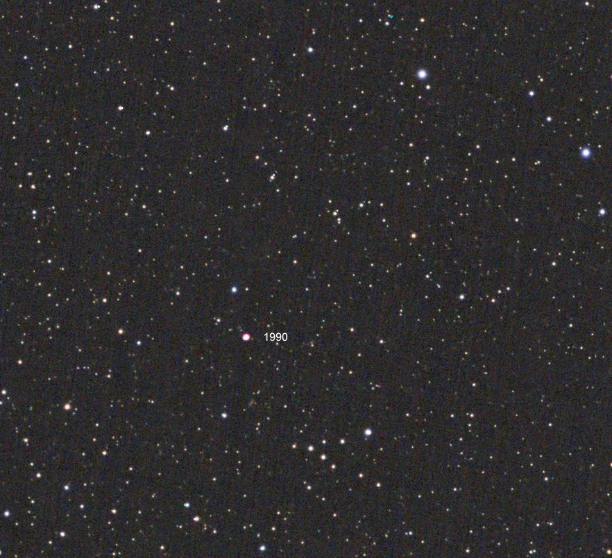 *Source [Mark's Astrophotography](https://mlastro.coffeecup.com/moving-stars.html)*

### Why only nearby?

![Diagram illustrating the radial velocity, proper motion, and space velocity of a star. At bottom left is a yellow disk representing the Sun. On the upper right is a smaller orange disk representing a distant star. A dashed, straight line connects the centers of the Sun and the star. (Above, to the left and parallel to this dashed line is a solid line with arrows at each end terminating at what would be the centers of both stars. This line is the total distance, d, separating the Sun and this hypothetical star.) Another dashed, straight line is drawn from the Sun, below and at an angle (shown as the Greek letter mu), from the dashed line that connects the Sun and star. The angle, mu, between these dashed lines is the measured proper motion of the star as seen from the Sun. In this case the star is moving to the upper left in the diagram. Three arrows are drawn from the center of the distant star. Each arrow represents the components of the star’s motion through space that contributes to its measured proper motion. The first arrow points directly away from the Sun toward the right, along the projected path of the dashed line connecting the Sun and star. This represents the radial velocity, i.e. the velocity along our line of sight. At a right angle to this arrow, and pointing up and to the left from the star, is the arrow for the transverse velocity. The transverse velocity is perpendicular to our line of sight, and is what we see as proper motion. Between the two arrows is a third, in this case pointing straight up in the diagram, that represents the total space velocity of the star. It is the combination of the transverse and radial velocities.](img/stellar-motion.png) *Source [OpenStax Astronomy](https://openstax.org/books/astronomy/pages/17-4-using-spectra-to-measure-stellar-radius-composition-and-motion)*

Large distance means small angular change

### Motion over time
Stars in our galaxy are moving at hundreds of kilometers per second
BUT:  They are so far away that we can not see stellar movement by eye 

Noticeable changes take tens of thousands of years (movie to 100000AD)

<figure>
<video controls autoplay loop muted playsinline width="600">
  <source src="../img/uma.mp4" type="video/mp4">
  Your browser does not support HTML5 video.
</video>
  <figcaption>
    The Big Dipper changing shape over tens of thousands of years as its stars move through space.
    Source: <a href="https://www.astronomy.ohio-state.edu/pogge.1/Ast162/Movies/proper.html">Richard Pogge, Ohio State University</a>.
  </figcaption>
</figure>

## Doppler shift

We can still learn about how fast distant stars and other astronomical objects are moving:

Throughout the Milky Way Galaxy

Stars in other galaxies

Jets and disks of gas around a black hole

<figure>
<video controls autoplay loop muted playsinline width="600">
  <source src="../img/doppler-car-horn.mp4" type="video/mp4">
  Your browser does not support HTML5 video.
</video>
  <figcaption>
    The pitch of a car horn changes as it passes us
  </figcaption>
</figure>

The way a speeding car sounds is due to properties of sound waves. Light waves show the same effect.

Source moving towards us seems to have shorter wavelength:

Pitch sounds higher,   Light looks bluer 

Source moving away seems to have longer wavelength:

Pitch sounds lower,   Light looks redder

### Stationary source, stationary observer

Circles mark the “crests” of outgoing waves
Wavelength: distance between crests

### Moving source

Source moves to right.

Observer on left side: Wavelengths appear longer:
redshift

Observer on right side: Wavelengths appear shorter:
blueshift

Observer looking from top or bottom side: Wavelengths do not change

### Moving observer, stationary source?
Same observed shifts in wavelength/frequency: doppler effect comes from relative motion

## Uses of Doppler

### Radar for car speeds

Radio reflects off your car.

 *Source [Jeff Gritchen, Orange County Register/SCNG](https://www.ocregister.com/2021/07/30/those-electronic-speed-signs-are-there-to-help-you-not-cite-you/)*

### Weather radar with doppler

Radio waves reflecting of clouds and precipitation. How storms move

## Medical ultrasound doppler

Sound waves reflect. Motion of fluid.

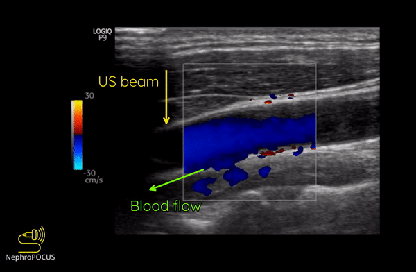

## Doppler and Spectra

- Absorption and emission spectra have lines at precisely predicted wavelengths.

- Doppler shift shifts the wavelength of the lines in the spectra.

- Astronomers use the Doppler Effect to learn about radial motions (toward or away from the observer, along the line of sight) of light sources (stars, galaxies). 

- It works for objects that are so far away that we see no change in their position in the sky!

### Example: hydrogen

Top: not moving
Middle: Moving toward you at 3000 km/s
Bottom: Moving toward you at 30,000 km/s

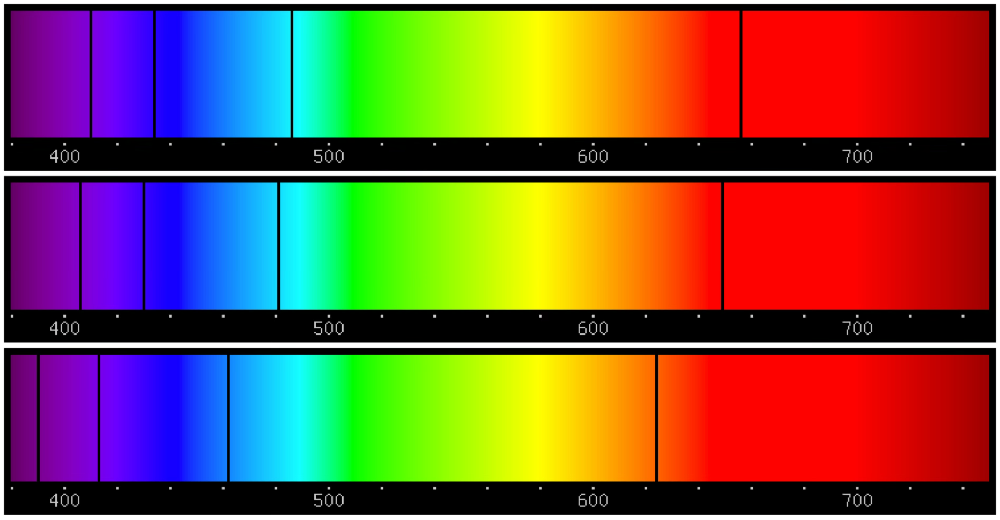

### Doppler and color

Important note:  most doppler shifts are too tiny to significantly change the color of an object!

For a red object to “look blue”, you need to move toward it at more than 100,000,000 mph

## Doppler and plots

The Hydrogen red emission line ($H\alpha$) has a wavelength of 656nm when measured in the lab.

Is this source moving toward us or away from us?

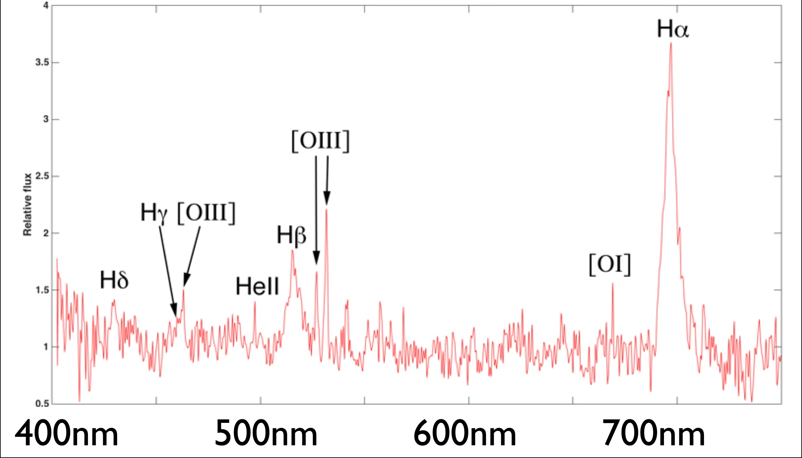

It is moving

away, because the wavelength is longer.

## Doppler of the Sun

Light from the Sun has an absorption spectrum

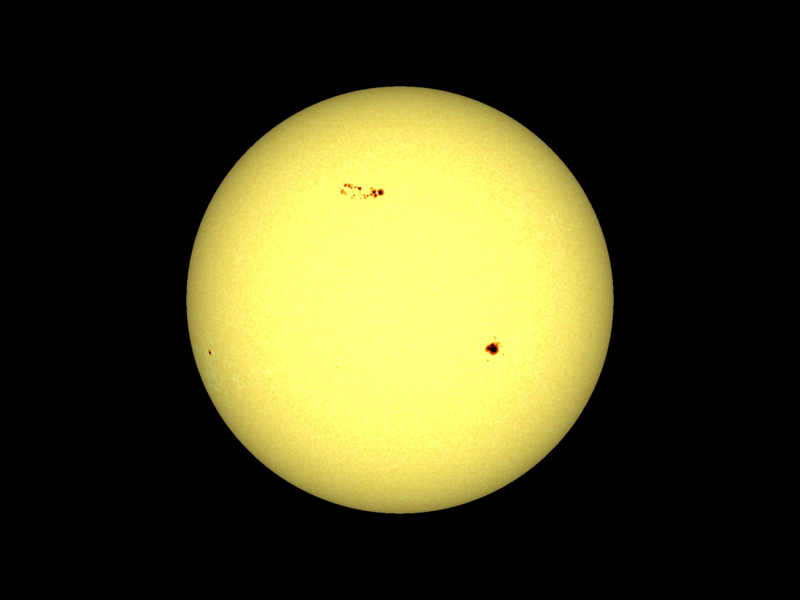

Rotation of sun shifts the absorption lines.

Shown here is a false color plot of the size and direction (red or blue) of the doppler shift.

Evidence of motion on the solar surface

<figure>
  <video controls autoplay loop muted playsinline width="700" style="max-width:100%;">
    <source src="https://svs.gsfc.nasa.gov/vis/a000000/a003900/a003990/SDOHMIdoppler_Jewelbox_HD720.mp4" type="video/mp4">
    Your browser does not support HTML5 video.
  </video>
  <figcaption>
    Dopplergram of the Sun from NASA's Solar Dynamics Observatory.
    Blue indicates motion toward us; red indicates motion away.
    The large-scale color pattern reveals the Sun's rotation,
    while smaller variations reveal motions of gas at its surface.
    Source: <a href="https://svs.gsfc.nasa.gov/3990">NASA/GSFC
    Scientific Visualization Studio, SDO Science Team,
    and Virtual Solar Observatory</a>.
  </figcaption>
</figure>

NOTE: examples often use false red/blue colors to indicate redshift and blueshift The apparent color may not actually change significantly.

Gas in the Sun's outer layers produces emission lines.

Motion of loops of plasma on the Sun's surface produce hydrogen emission

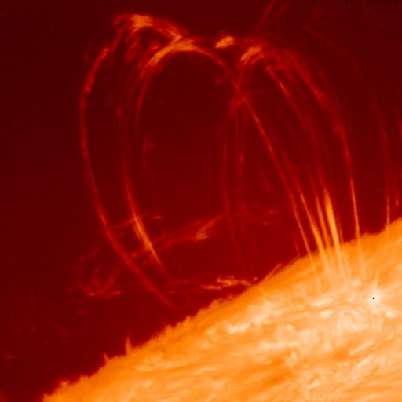
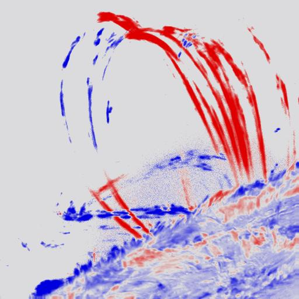

*Source: [NASA Marshall Space Flight Center — Post-Flare Loops](https://solarscience.msfc.nasa.gov/loops.shtml). Observations: T. Tarbell and B. Schmieder.*

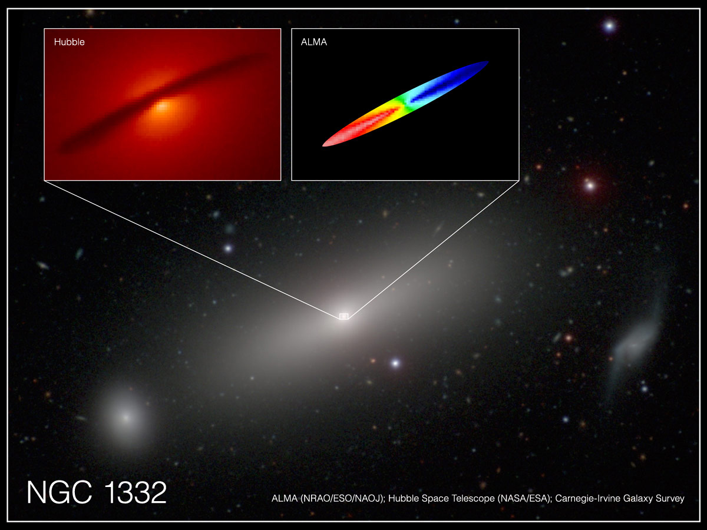
*Source [A. Barth (UC Irvine), ALMA (NRAO/ESO/NAOJ); NASA/ESA Hubble; Carnegie-Irvine Galaxy Survey.](https://www.almaobservatory.org/en/press-releases/alma-measures-mass-of-black-hole-with-extreme-precision/)*

## Learning from Starlight

Learning from starlight:
- A star’s chemical composition
  - Pattern of lines in the absorption spectrum at a given temperature
- A star’s surface temperature
  - Peak wavelength of the underlying thermal spectrum (color), pattern of absorption lines
- A star’s motion relative to us
  - The Doppler Effect shifts absorption lines

### In the Milky way

We can combine proper motion and redshift to understand the motion of stars in the Milky Way

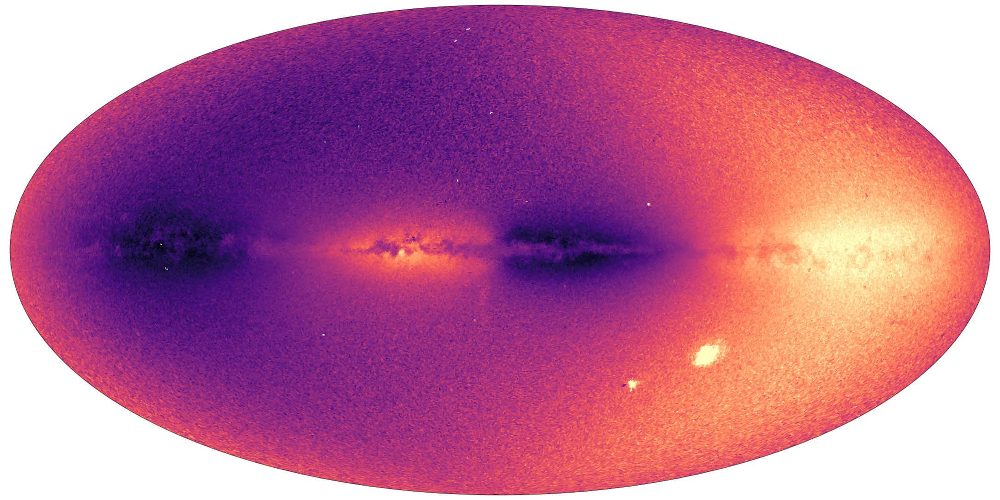
*Source[ESA/Gaia/DPAC](https://www.esa.int/ESA_Multimedia/Images/2022/06/Gaia_s_Milky_Way_in_motion)*

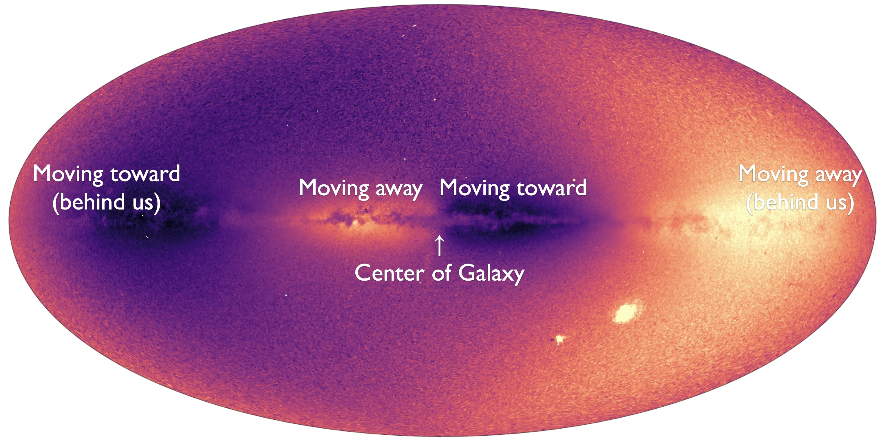

## Doppler and planets

What kind of motion would produce this shift in a spectrum?

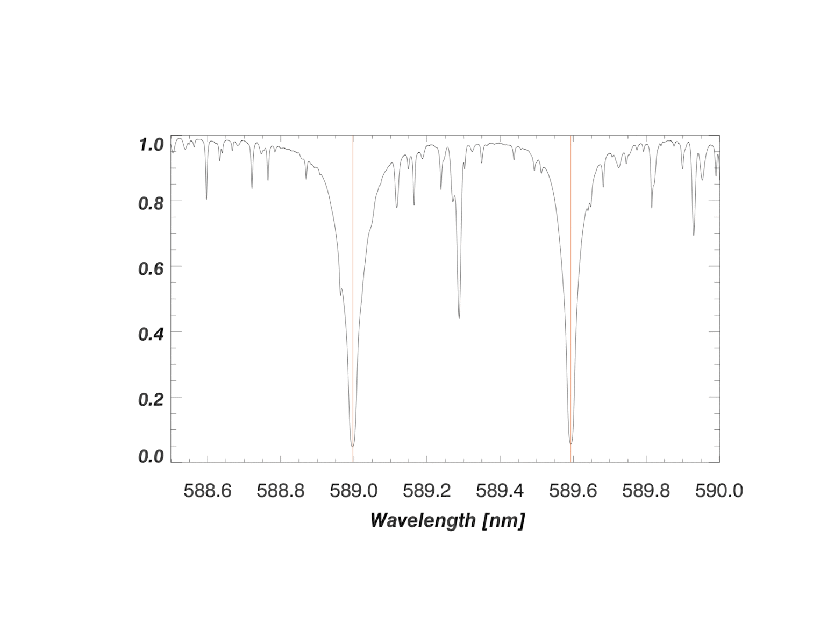

### Exoplanets and Doppler

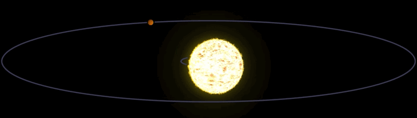

Gravitational forces lead to
- Large acceleration of planet
- Smaller acceleration of star

Periodic small doppler shift of stellar spectra gives planet candidates 

## Black holes with Doppler

Combine visible light and radio doppler

disk of gas orbiting center of galaxy 
speeds over 1 million mph

Kepler’s laws: black hole of 660 million solar masses 

## Check your Understanding

<quiz>
The Doppler Effect causes light from a source moving away from the observer to:

- [] be shifted to shorter wavelengths.
- [x] be shifted to longer wavelengths.
- [] change in velocity.
- [] change in velocity and shift to shorter wavelenths.
- [] change om velocity and shift to longer wavelengths.

All light travels at the same speed

</quiz>

<quiz>

A bright yellow star is moving away from Earth.  If you were to look at the spectrum of this star, what would it look like?

- [x] an absorption spectrum that is redshifted relative to an unmoving star
- [] an emission spectrum that is redshifted relative to an unmoving star
- [] a continuous spectrum that is blueshifted relative to an unmoving star
- [] an absorption spectrum that is blueshifted relative to an unmoving star

</quiz>