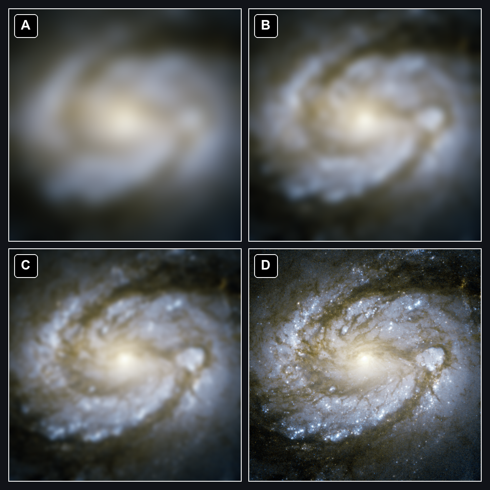
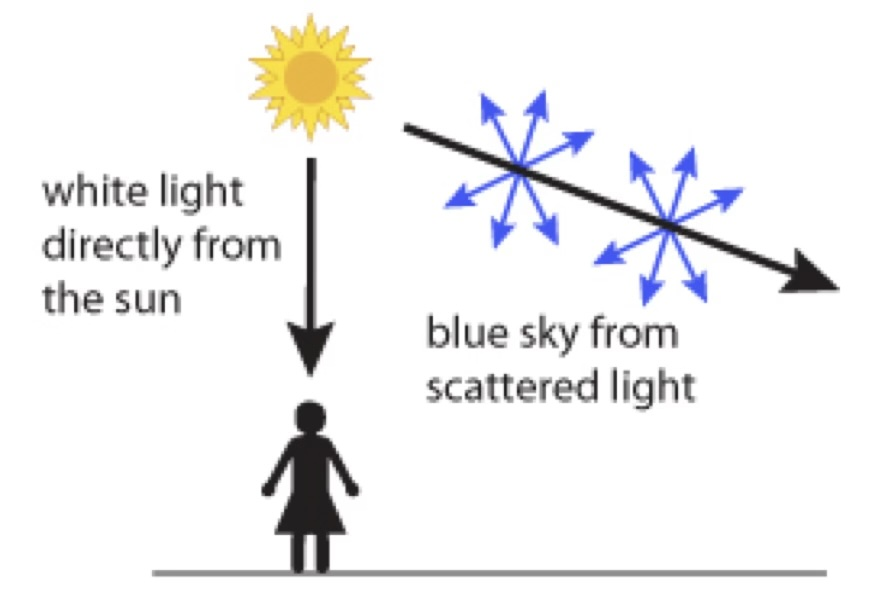
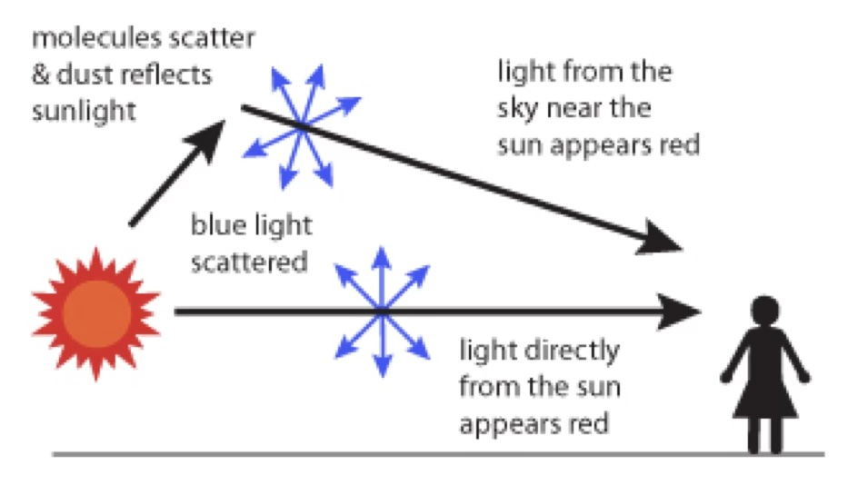
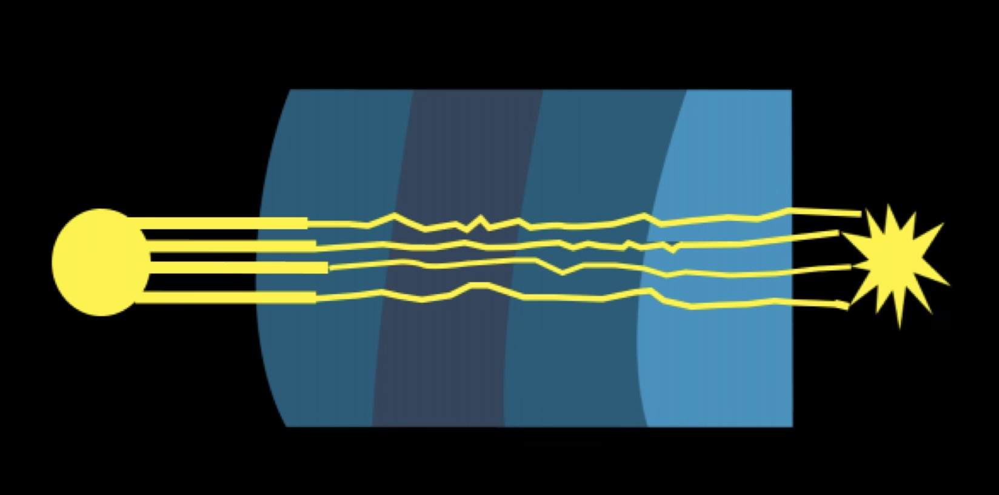
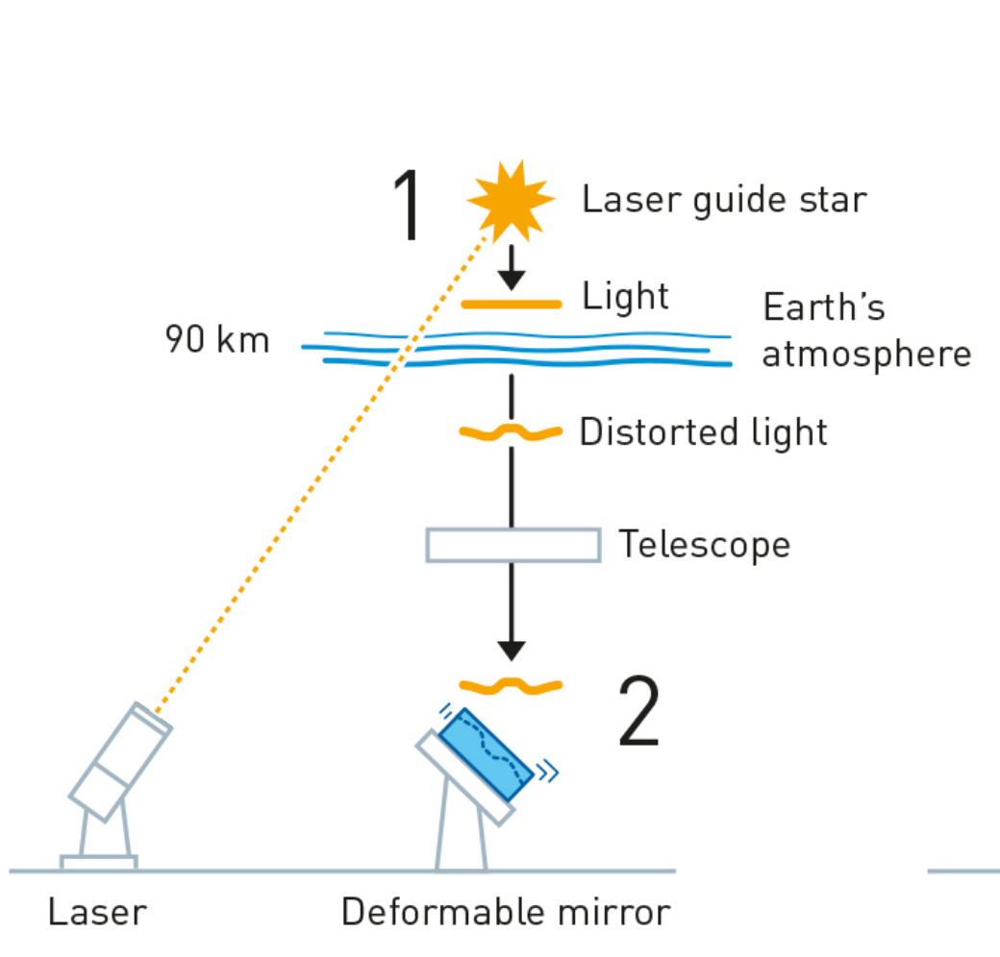
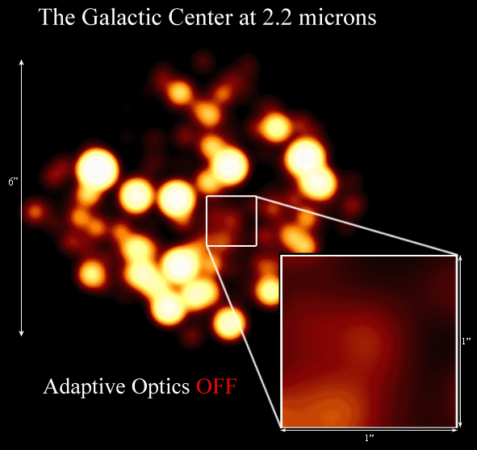
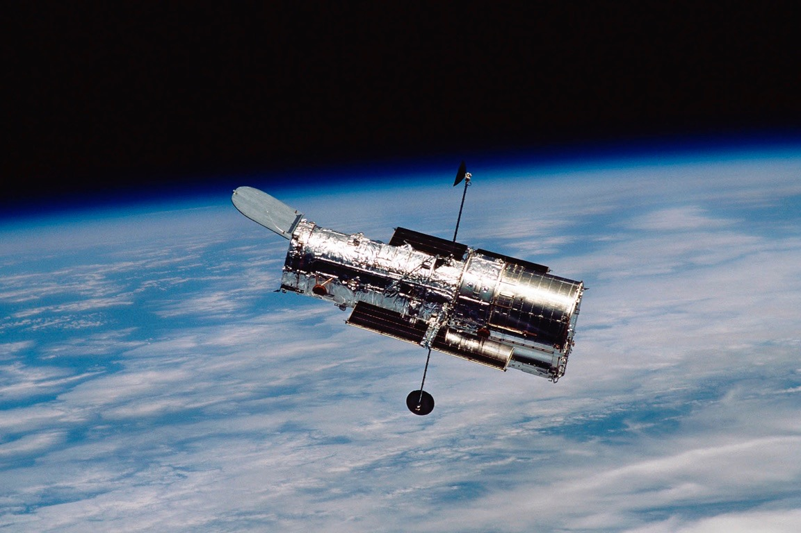

# Telescopes and Earth's Atmosphere

## Telescopes

Telescopes collect light from distant objects and focus it on to a light-collecting device (like your eye, or a camera)

 *Source [OpenStax Astronomy](https://commons.wikimedia.org/wiki/File%3AOpenStax_Astronomy_refracting_and_reflecting_telescopes.jpg)

 *Source: [Science News](https://www.sciencenews.org/article/james-webb-space-telescope-launch-space-science-cosmos-exoplanets)*

### Refracting telescope

- Type used by Galileo
- Glass lenses focus the light from distant objects
- Limited by the size of the lenses

 *Source [Yerkes Observatory](https://www.instagram.com/p/DaOZFltiYEI/)*

### Reflecting telescope
- Uses curved mirrors to focus the light
- Can be made much larger than refracting telescopes

 *Source: Jocelyn Read*

 *Source [H. Raab](https://en.wikipedia.org/wiki/Gran_Telescopio_Canarias#/media/File:GranTeCan_Mosaic.jpg)*

#### Rubin Observatory

Mirror

Largest digital camera in the world 

*Source: [Rubin Observatory](https://rubinobservatory.org/explore/how-rubin-works/technology)*

## What telescopes do

### More light
Telescopes can make images of dim objects because they collect more light than a human eye

Light collected is proportional to area of collection x exposure time

Binocular view on a clear night:

Backyard astrophotography (telescope collecting area 3” across, 3 hours worth of total exposure time)

### More detail

Telescopes increase the angular resolution of the image they produce

The angular resolution of the human eye is about 1 arcminute (1/60 of a degree)

The angular resolution of JWST and the Hubble Space Telescope is 0.05 arcseconds (0.05 * 1/3600 of a degree)

*Base image: [ESA/Hubble & NASA](https://esahubble.org/images/potw1203a/)*

Note: all these images have the same magnification! 

Magnification alone does not improve telescope capabilities.

## Light and Earth's Atmosphere

Light scattering:  the atmosphere absorbs blue (short-wavelength) light and emits it in random directions

Scatter depends on wavelength!

(Space looks black because no atmosphere scatters light)

Sunsets look red because blue light is scattered away as it travels through a lot of atmosphere.

Red light (longer wavelength) is left.

## Atmosphere and telescopes

- Earth’s atmosphere can absorb or distort light
- Stars twinkle

- Adaptive Optics 
- Observatories track the sky’s distortion with lasers

  <iframe
    src="https://player.vimeo.com/video/241972548"
    style="position:absolute;top:0;left:0;width:100%;height:100%;"
    frameborder="0"
    allow="autoplay; fullscreen; picture-in-picture"
    allowfullscreen>
  </iframe>

 *Source [nobelprize.org](https://www.nobelprize.org/prizes/physics/2020/press-release/)*

This was needed to track the stars around Sgr A*

 *Source [UCLA Ghez Group](https://galacticcenter.astro.ucla.edu/)*

## Telescopes in Space

Leaving the atmosphere can give even better resolution

Example: improvement from the JWST for viewing a patch of sky from space

 

## Telescopes and other Forms of Light

We don’t limit observations to visible light

We use the entire electromagnetic spectrum to observe the Universe

Telescopes have to use different technologies to focus different frequencies of electromagnetic waves

FAST observatory in Guizhou, China

 What kind of wavelength needs such a huge reflector?

This radio telescope measures very long-wavelength light.

It uses large elements to collect and focus radio light!

The Chandra X-ray telescope uses metal rings to focus the incoming radiation

## Atmosphere across forms of light

Optical window: visible light reaches ground, as well as some  infrared and some ultraviolet.

Radio window: radio light reaches ground

## Check your understanding

<quiz>
A telescope’s resolution tells you about

- [] The size of the telescope opening 
- [x] The ability to distinguish objects that appear close together in the sky 
- [] Computer-controlled active focusing to compensate for atmosphere effects 
- [] The size of objects as they appear in the telescope
</quiz>
