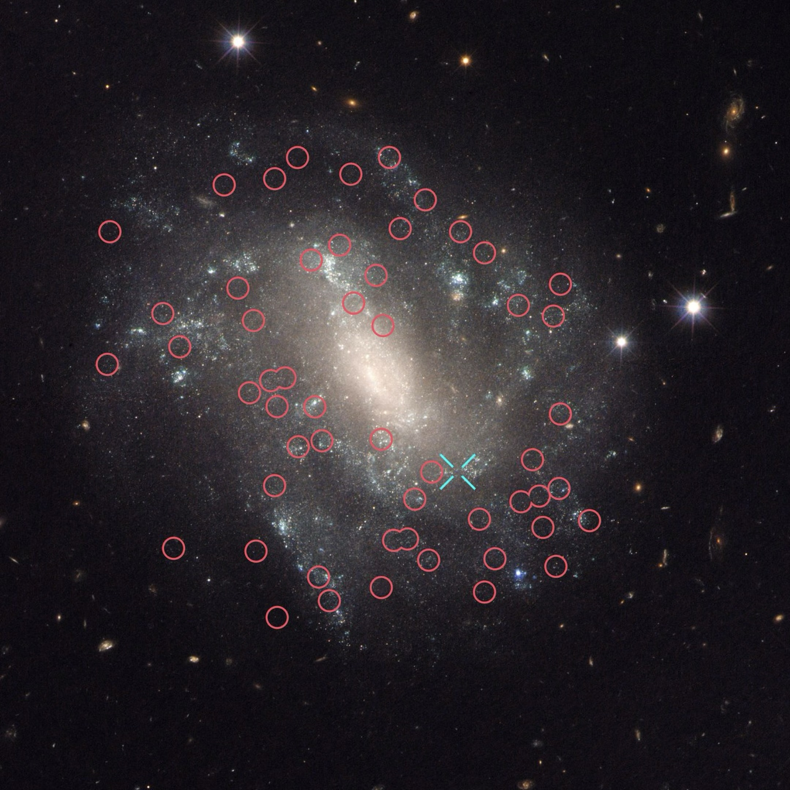
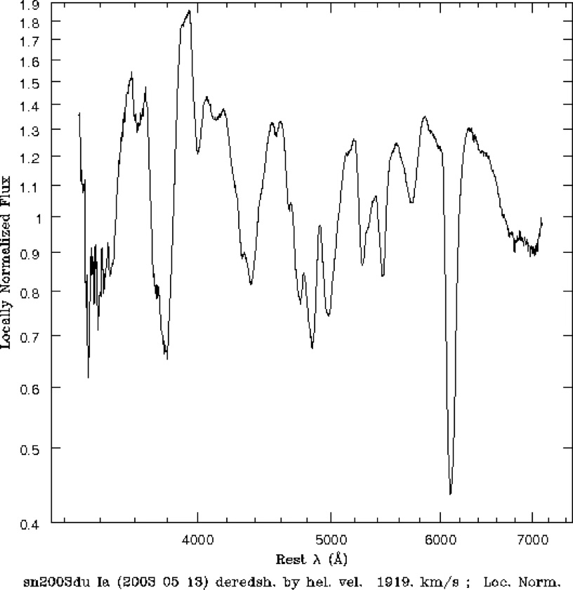
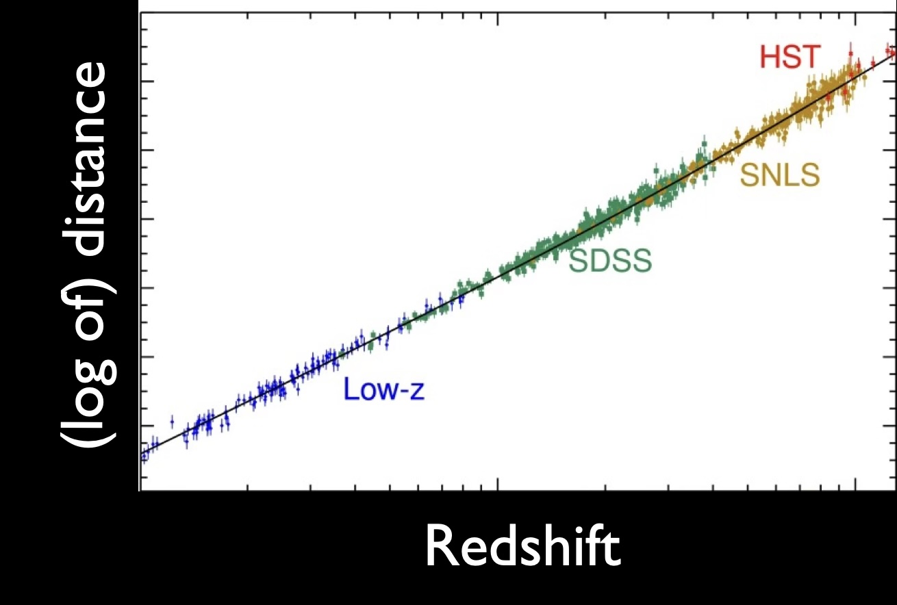
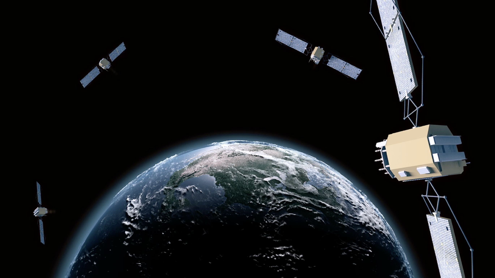
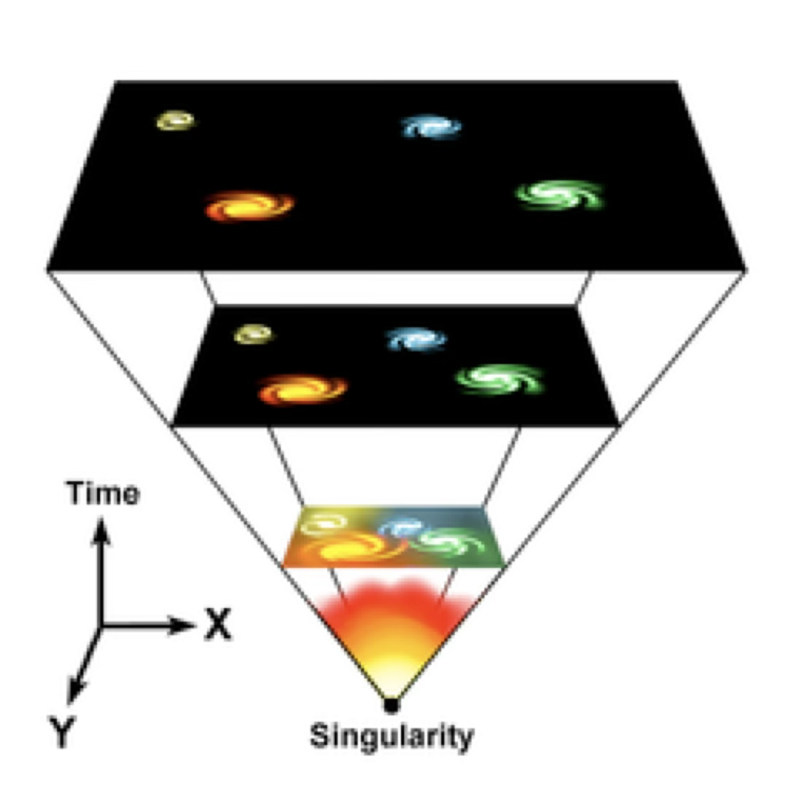

# The Expanding Universe
Redshift of galaxies
Hubble’s Law
Expansion
Space and Time
The Big Bang

## Galaxies and redshft

In 1912 at Lowell Observatory in Flagstaff, Arizona, Vesto Slipher was the first to measure the redshift of  “spiral nebula”  (now known as a galaxy).
It was moving away from us at a very high speed.

Observe these shifts in hydrogen (H) calcium (K) absorption lines for these "Cluster nebula" galaxies, compared to lab emission reference lines. 

| Galaxy   | Redshift (km/s) |
| --------------- | --------------- |
| Virgo           | 1,200           |
| Ursa Major      | 15,000          |
| Corona Borealis | 22,000          |
| Bootes          | 39,000          |
| Hydra           | 61,000          |

Why would they all be moving away?

Was there a pattern?

Look at the size of the galaxies

If galaxies are mostly the same size (they aren't always), the bigger ones would be closer.

Here are their distances:

| Galaxy   | Distance (light-years) |
| --------------- | ---------------------- |
| Virgo           | 78,000,000             |
| Ursa Major      | 1,000,000,000          |
| Corona Borealis | 1,400,000,000          |
| Bootes          | 2,500,000,000          |
| Hydra           | 3,960,000,000          |

In 1929, Edwin Hubble and Milton Humason put observations of distance and redshift together for many galaxies.

Distant galaxies all appear to be moving away from us.

The more distant they are, the faster they appear to move.

## The Hubble Constant

This plot shows velocity from redshift vs distance from nearby galaxies.

It is used to estimate the "Hubble constant," the slope of the best fit line.
 *Source: [Freedman et al. 2001, The Astrophysical Journal 553, 47](https://www.astroexplorer.org/details/10_1086_320638_fg1)*

This estimates the Hubble Constant $H$ to be
$H = 75 km/s/Mpc$

If you know $H$, then speed = H × Distance

## The Expanding Universe

Doppler measurements show that distant galaxies all appear to be moving away from us.

The more distant they are, the faster they appear to move.

Interpretation: the universe is expanding

Note:  galaxies themselves (gravitationally bound objects) do not expand! 

## Raisin Cake Demo

How does expansion cause this pattern?

Imagine a rising cake filled with raisins:

<figure>
  <video controls style="width:100%;height:auto;"
         aria-label="Animation of raisins moving apart as cake batter expands"
         aria-describedby="raisin-cake-caption">
    <source src="img/raisin-cake.mp4" type="video/mp4">
    Your browser does not support the video tag.
  </video>
  <figcaption id="raisin-cake-caption">
    Animation of a rising raisin cake illustrating the expansion of the universe.
    As the cake expands, every raisin moves away from the others; raisins that begin
    farther apart gain more separation during the same interval.
  </figcaption>
</figure>

closer raisin 1: 
- starts 1 cm away
- ends 3 cm away
- moves 2 cm in 1 hour

furthest raisin 3:
- starts 3 cm away, 
- ends 9 cm away
- moves 6 cm in 1 hour

Here's a Hubble Plot for an expanding cake:

We write the expansion rate as 1 cm / s / cm

For every cm away we go, the speed is that many cm/s

The observation is the same from every reference raisin.

## Distance Ladder

*Source: [NASA, ESA, A. Feild (STScI), and A. Riess (STScI/JHU)](https://science.nasa.gov/asset/hubble/three-steps-to-hubble-constant-artists-illustration/)*

Modern observations use both Cepheids and a particular type of stellar explosion as Standard Candles

- Parallax of Cepheids in the Milky Way out to 10,000 light years
- Galaxies hosting Cepheids and Type 1a supernovae from 10,000 to 100 Million light years
- Distant galaxies hosting Type Ia supernovae out to 1 billion light years.

### Nearby supernova

*Source: [NASA, ESA, and A. Riess (STScI/JHU) et al.](https://science.nasa.gov/asset/hubble/galaxy-ugc-9391/)*

UGC 9391: 130 million light-years from Earth

Circles mark Cepheid variable stars

The x marks a Type Ia supernova

The supernova spectrum was measured

Supernova redshift: 4300 miles per hour

### Distant supernova

Most distant Type Ia supernova:

10,500,000,000 light-years away

0.8 times light-speed

*Source: [NASA, ESA, A. Riess, D. Jones, and S. Rodney](https://science.nasa.gov/missions/hubble/hubble-breaks-record-in-search-for-farthest-supernova/)*

## Distance measure vs redshift

Astronomers usually make this type of plot, which flips the axes from a hubble plot.

We can measure the universe expansion rate out to billions of light years away.

## Space and time

What makes a universe?

What is expanding?

We experience three dimensions of space:
- back and forth
- left and right
- up and down

We also experience time
- only in one direction 
- “arrow of time”

4 dimensions: position x, y, z and time t 

## Einstein's space and time

Einstein’s “thought experiment:”
- All light travels at the same speed.
- What happens if you chase after a beam of light?

To measure the same the speed of light…
 - Length measurements and clock ticking rates must be different for moving observers

Space and time are dynamic, changing things.

Einstein's gravity:
- Matter tells spacetime how to curve.
- Spacetime tells matter tells how to move.

### Application: GPS

*Source: [NASA Goddard Space Flight Center](https://science.nasa.gov/universe/black-holes/a-century-of-general-relativity/)*

Compared to Earth surface clocks, 
the clocks on GPS satellites tick:

- 7  microseconds per day slower from motion
- 45 microseconds per day faster from gravity

Without relativity: 10 km per day accumulated error

## The balloon demo

  <iframe
    src="https://www.youtube.com/embed/GEJp2s7oGzw?autoplay=0"
    style="position:absolute;top:0;left:0;width:100%;height:100%;"
    title="Balloon demonstration of the expanding universe"
    frameborder="0"
    loading="lazy"
    allow="fullscreen; picture-in-picture"
    allowfullscreen>
  </iframe>

You'll see a balloon used to demonstrate the expanding universe.

Represent the 3-dimensional space in the universe by the 2-dimensional surface of the balloon

This lets the balloon expand using the 3rd dimension of real space

The real universe expands everywhere from everywhere 

- no evidence of a higher dimension it expands into.
 - no center

Space expands, carrying galaxies apart

Galaxies stay bound together by gravity

## Expanding spacetime

In the expanding universe, space itself expands:

Expanding space carries galaxies with it.

Traveling waves of light are stretched by expansion (an alternative interpretation of distant redshifts).

## The Big Bang

Georges Lemaître,
Catholic Priest and Physics professor,
1894-1966

“Cosmic Egg,”
Lemaître, 1931: If the universe is expanding, it must have a starting point:
a very compact, dense, state

The expansion of the Universe suggests that originally everything was packed together

Expansion from this initial state is called the “Big Bang”

![Animation of expanding space.] (img/bigbang.gif)

## Check your understanding

<quiz>
How many dimensions of space are there on the surface of a balloon?

- []   1
- [x]  2
- []  3
- []   4
</quiz>

<quiz>
Here are four characteristics of the real universe:

The real universe has no center. 
The real universe has no edge. 
The real universe expands. 
The real universe has 3 dimensions of space.

Which of these characteristics describe the surface of the balloon in the expanding balloon model?

- [x] The balloon surface has no center. 
- [x] The balloon surface has no edge. 
- [x] The balloon surface expands. 
- [] The balloon surface has 3 dimensions of space.

</quiz>

<quiz>
In the “balloon demo,” what aspect of the real universe did the air inside of the balloon represent?

- []   space and time
- [] the center of the universe
- [x]  our real universe doesn’t have anything like that
- [] space where the universe used to exist 
</quiz>

<quiz>

What has occurred since the Big Bang? 

- []  Objects that were once close together have moved apart from each other into space that used to be empty.
- [x] Objects that were once close together have moved apart as the space they are in expanded. 
- []  Empty space has expanded out from already existing objects without changing the distance between them. 

</quiz>

<quiz>
Which of the following best describes the Big Bang?

- [ ] An explosion of matter and energy into empty space at the beginning of the universe.
- [ ] An explosion of matter and energy, at the beginning of the universe, into regions of space where other matter already existed.
- [x] The expansion and cooling of the whole universe, including space itself, from an originally hot and dense state.
- [ ] More than one of the above.
- [ ] None of the above.

</quiz>