# Forms of Light

## 

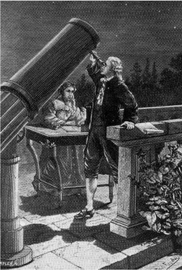
William Herschel (1738-1822) and Caroline Herschel, musician-astronomers (1750-1848)

William measures the heat and illumination of different colors of sunlight 

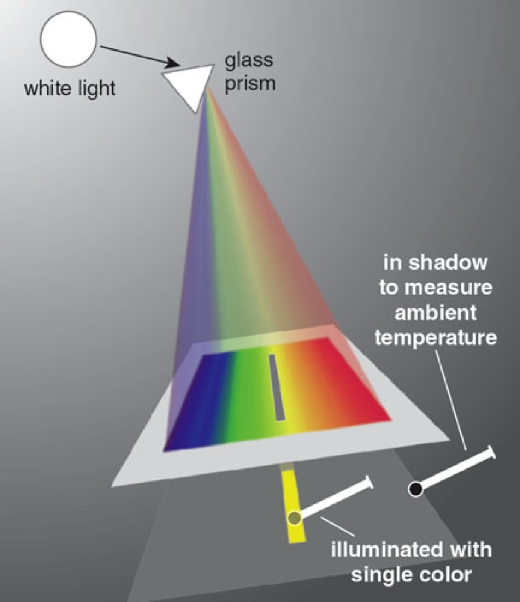

The emission of the Sun extends past visible light 

Those wavelengths also carry energy!    

Herschel discovered infrared

Humans give off infrared light.

An infrared camera uses false colors to show the infrared light from CSUF Physics and Astronomy Professor Joshua Smith and his dog Steve.

## Electromagnetic Spectrum

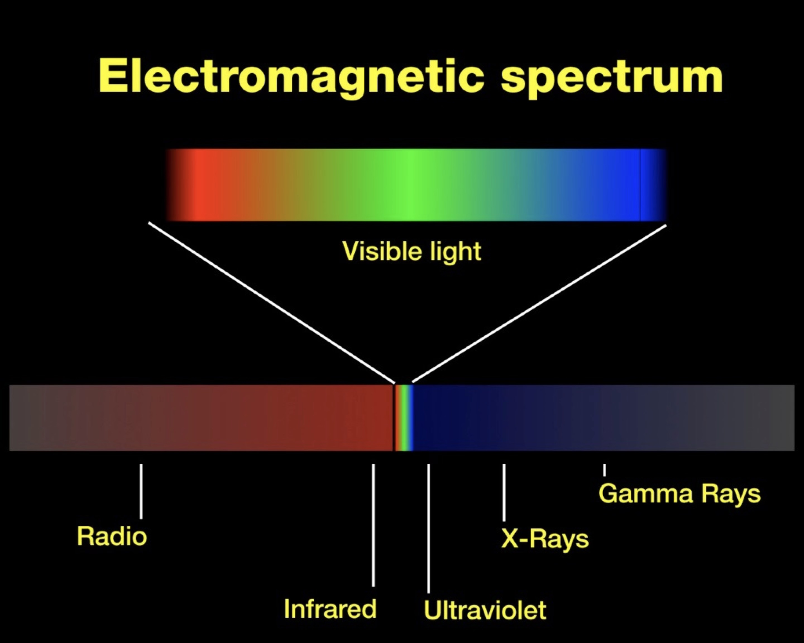

- Electromagnetic radiation around us:

  - Radio waves from AM/FM radio and microwaves from WiFi

  - Visible light from the overhead lights or Sun

  - Ultraviolet from the Sun

  - Infrared emitted by other humans and animals, the Sun

- Most wavelengths have low energy and are harmless to humans

- High energy light may require more care

  - X-rays

  - Gamma radiation

## The sky in different forms of light

"Pillars of Creation" is a photograph taken by the Hubble Space Telescope of interstellar gas and dust forming stars in the Eagle Nebula, about 7,000 light years from Earth.

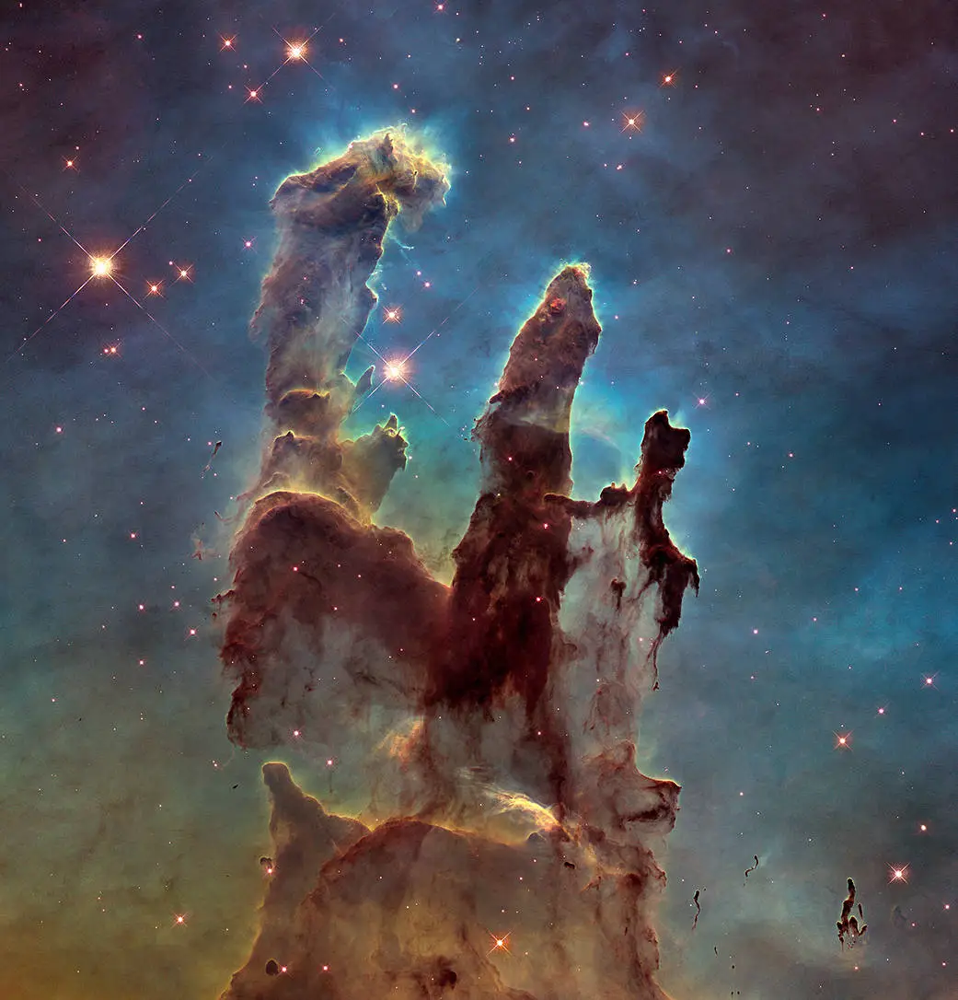

NASA’s James Webb Space Telescope’s near-infrared-light view of the same structure.

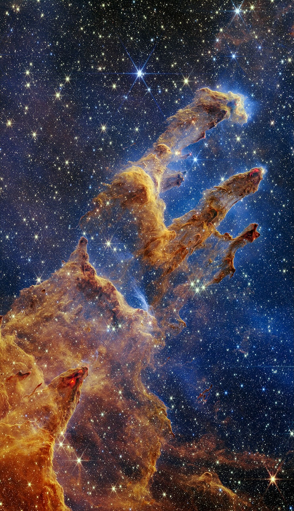
 
We can see through the dust with infrared light.

Observing electromagnetic waves at different frequencies gives us different views of the Universe

## Sky Views

A map of the Earth (winter in the Northern Hemisphere)
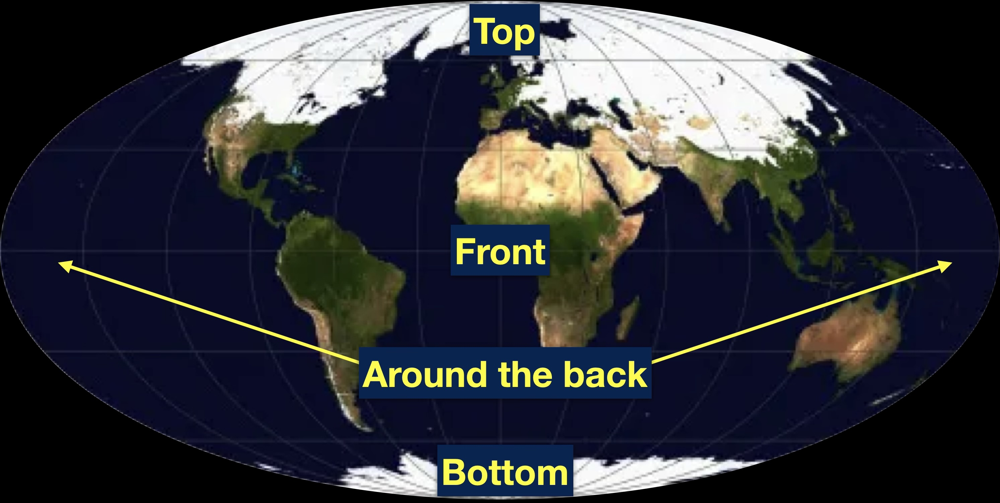

Shows all directions, including the "back", "top", and "bottom."

A map of the sky as seen from Earth - the full celestial sphere.

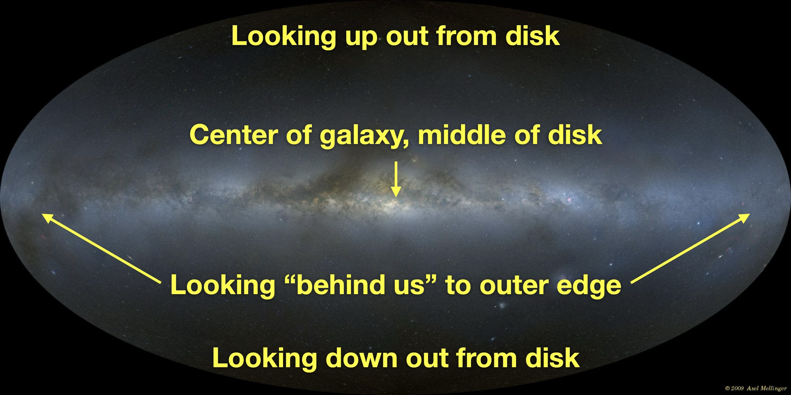

Our viewpoint to see the Milky Way Galaxy
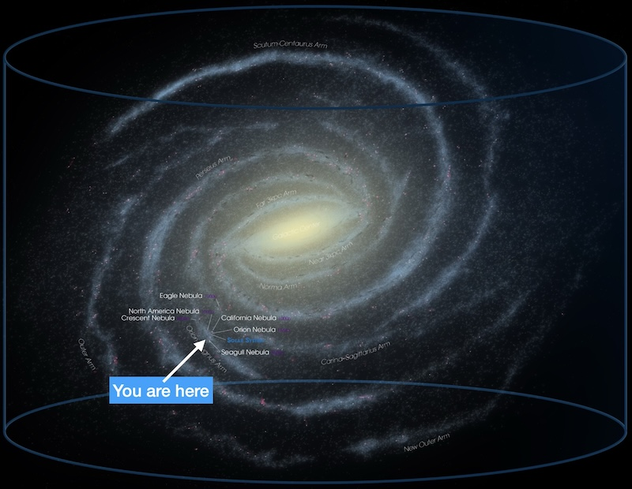

## The sky in different forms of light

### Low energy to high energy:

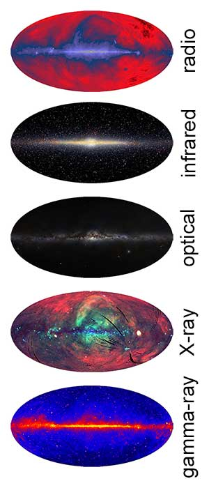

With increasing energy, we see 

- Electrons moving in magnetic fields (radio)
- Cool clouds of gas, cosmic microwave background (microwave)
- Warmer clouds of dust and gas (infrared)
- Stars and reflected starlight (visible)
- Supernovae remnants, very hot stars (ultraviolet)
- Supernova remnants, solar corona, gas in galaxy clusters (x-ray)
- Accreting material and jets launched by black holes and neutron stars (gamma-ray)

### Radio waves

produced by energetic electrons moving through magnetic fields

Glow of hydrogen gas

Loops - leftover plasma from nearby supernovae 

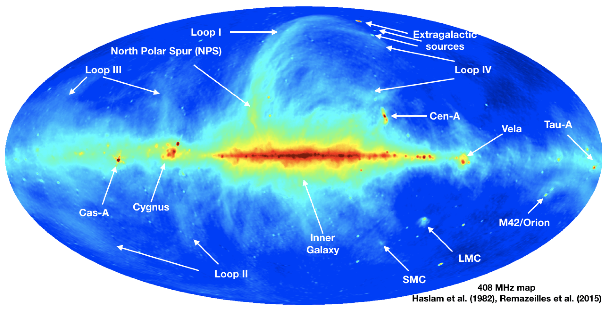
*Source [Dickinson, Remazeilles et al., Max Planck Institute for Radioastronomy Survey Sampler ](https://www.mdpi.com/2075-4434/6/2/56)*

### Microwave
Gas and Dust in the Galaxy

Uniform background glow from early universe

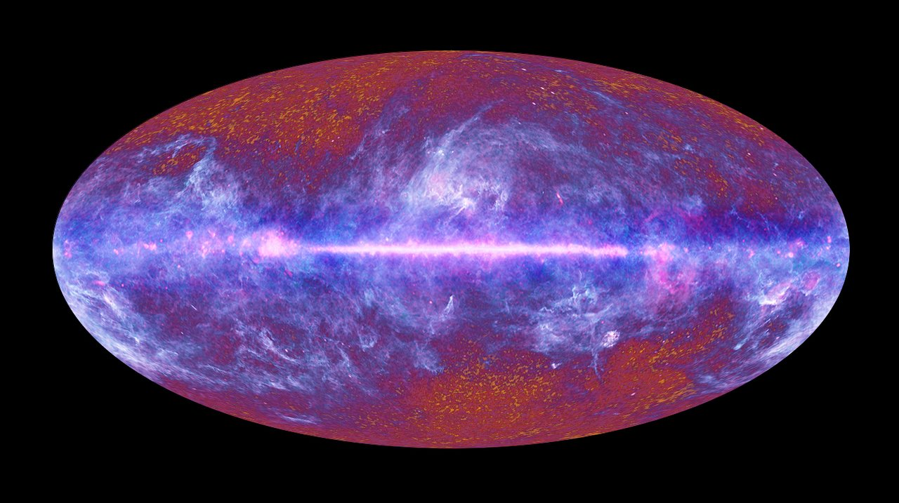
*Source [ESA, HFI and LFI consortia](https://supernova.eso.org/germany/exhibition/images/1009_F_PLANCK_FSM_03_Black_frame_orig-crop/)*

### Far Infrared

IRIS survey

Dust in the milky way, dust in our solar system, dust left over from making stars across the universe.

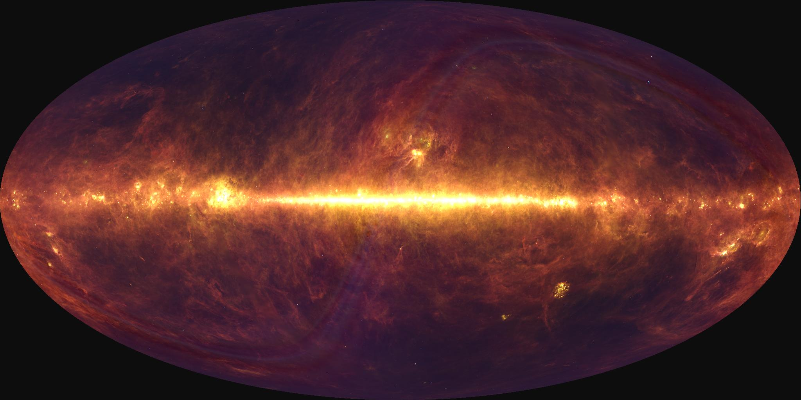 
*Source [IRIS](https://lambda.gsfc.nasa.gov/product/foreground/fg_iris_info.html)*

### Near Infrared
SPHEREx

Hotter dust

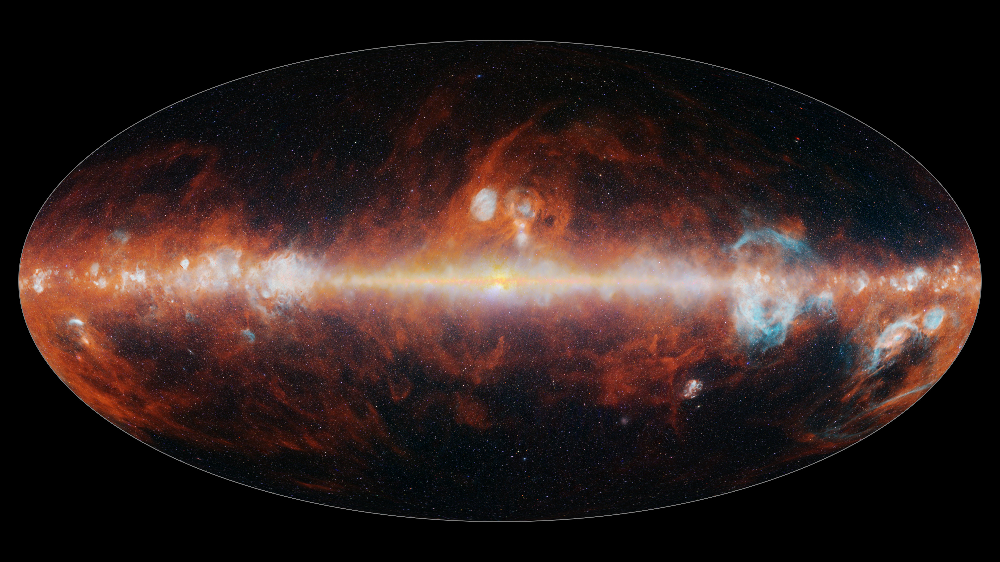
*Source [NASA/JPL-Caltech](https://www.jpl.nasa.gov/news/nasas-spherex-observatory-completes-first-cosmic-map-like-no-other/)*

### Optical

Stars and shadows from dust. Nearby galaxies.

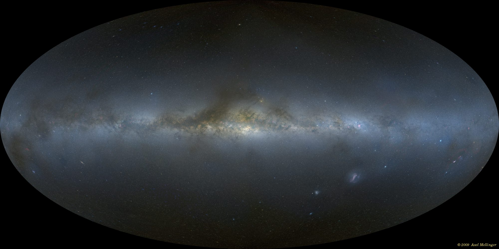
*Source [Axel Mellinger](https://www.milkywaysky.com/)*

### X-ray
High-energy processes: Galaxy clusters, Black holes, neutron stars, …

Shadows of cooler gas

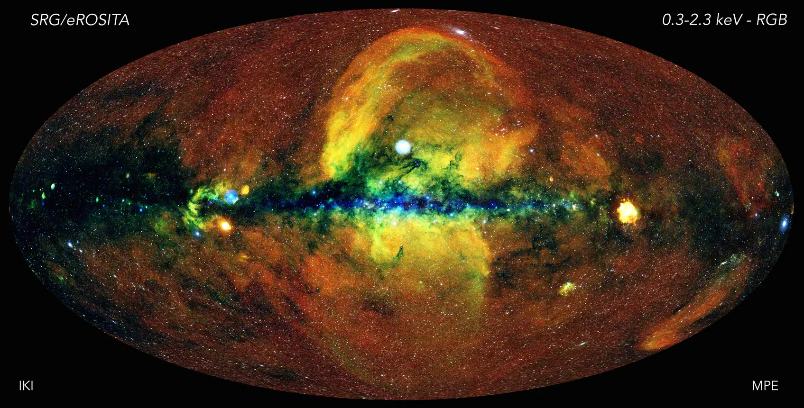
*Source [Jeremy Sanders, Hermann Brunner and the eSASS team (MPE); Eugene Churazov, Marat Gilfanov (on behalf of IKI)](https://www.mpe.mpg.de/7461950/erass1-presskit)*

### Gamma-ray

Highest energies: 
spinning neutron stars, distant galaxies with matter falling into supermassive black holes

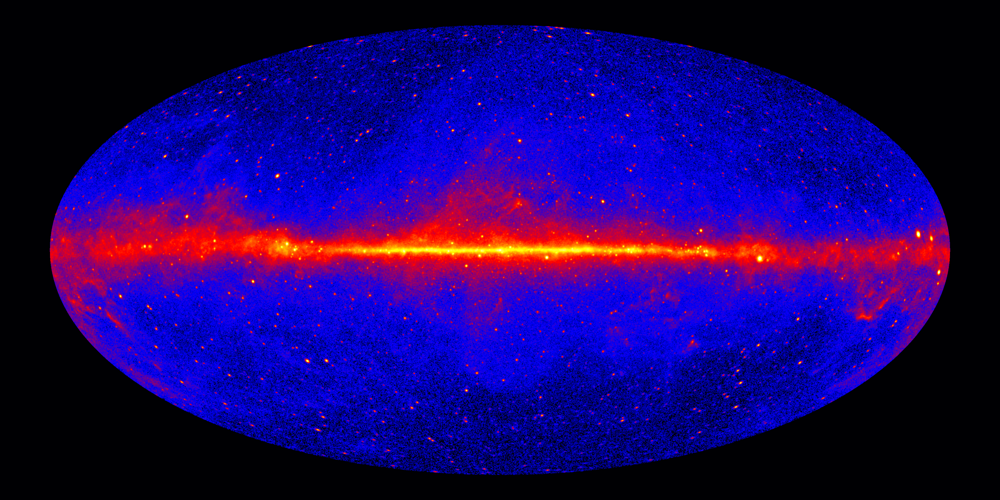
*Source [NASA/DOE/Fermi LAT Collaboration](https://svs.gsfc.nasa.gov/14976)*

## Learning from many wavelengths

### Crab Nebula
This is the Crab Nebula seen by different telescopes that record different forms of light.

!Comparison of the Crab Nebula in radio, infrared, visible, ultraviolet, and X-ray light, with each wavelength revealing different structures in the supernova remnant.](img/crab-different-views.jpg)

X-ray shows the jets from the energetic pulsar at the center. Visible and radio shows the expanding remnant from the explosion that formed it.

### Sgr A*

This is the Milky Way's supermassive black hole, Sgr A*, which is dark in visible and infrared light but has a halo (outside the horizon) that glows in radio and x-ray. (Lots of gravitational potential energy converted!!)

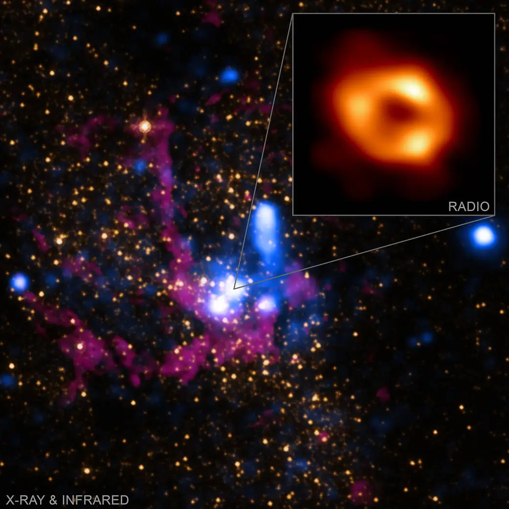

## Check your understanding

<quiz>
Astronomers observe the same star-forming region in visible and near-infrared light. The infrared image reveals many stars that are hidden in the visible-light image.

What is the best explanation?

- [] Infrared photons have more energy than visible-light photons, so they pass through dust more easily.
- [x] Infrared light is less strongly scattered and absorbed by interstellar dust.
- [] Infrared telescopes always have greater magnification than visible-light telescopes.
- [] The hidden stars emit infrared light but do not emit visible light.

</quiz>

<quiz>
Astronomers observe a supernova remnant using both visible-light and X-ray telescopes. The two images show different structures.

What is the best explanation?

- [] The visible and X-ray telescopes are observing two different objects that happen to be in the same direction.
- [] X-rays travel faster than visible light, so the X-ray image shows a more recent view.
- [x] Different parts of the remnant emit different wavelengths because they have different temperatures and physical processes with different energies.
- [] The X-ray telescope magnifies the remnant more than the visible-light telescope.

</quiz>

## Go farther

[Video Tour](https://www.youtube.com/watch?v=eE7-6fQ9_48) of [Chromascope](https://www.chromoscope.net/)