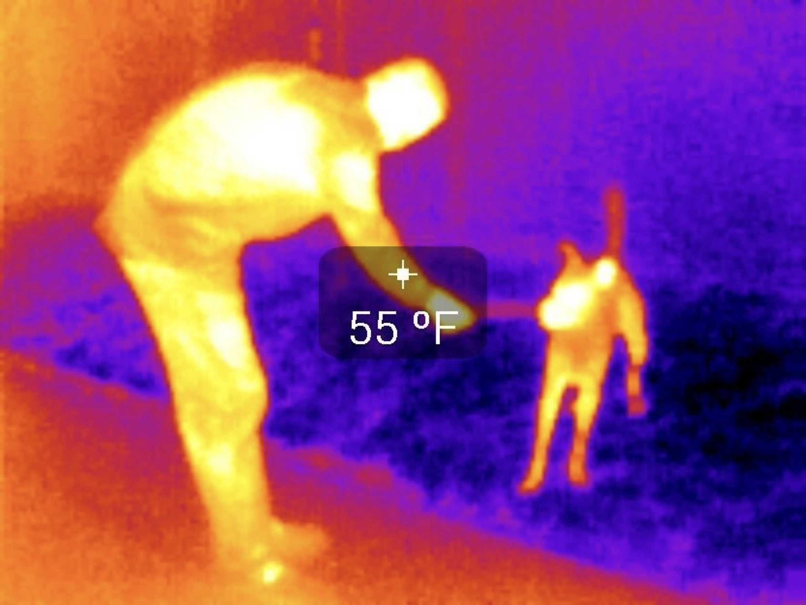

# Forms of Light

## 

Frederick and Caroline Herschel, musician-astronomers (1738-1822, 1750-1848)

Frederick measures the heat and illumination of different colors of sunlight 

The emission of the Sun extends past visible light 

Those wavelengths also carry energy!    

Herschel discovered infrared

This infrared camera images uses false colors to show the infrared light from CSUF Physics and Astronomy Professor Joshua Smith and his dog Steve.

## Check your Understanding