# Light

- Speed
- Colors
- Waves and Particles
- Wavelength
- Frequency
- Energy

## Questions about Light

- What is light?
- How fast does it travel?
- How much energy does it carry?
- What different kinds are there?

## The speed of light

In 1676, Danish Astronomer Ole Römer made a systematic study of the exact timing of eclipses of Io, one of the moons of Jupiter

<figure>
  <video controls width="100%">
    <source src="img/Jupiter-Moons.mp4" type="video/mp4">
    Your browser does not support the video tag.
  </video>
  <figcaption>
    Moons orbiting Jupiter, crossing across the planet view.
  </figcaption>
</figure>

For several months the eclipses lagged behind the expected time, then they caught up again.

Why?

As the Earth and Jupiter orbit, the distance between them changes

Changes in light travel time cause observed lags

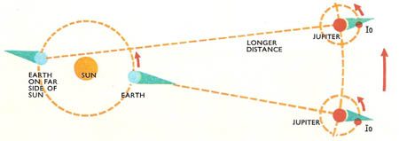

By the time Newton wrote the Principia, astronomers had confirmed that light traveled at a finite speed and “requires about seven or eight minutes to travel from the sun to the earth”

## Rainbows

[An ice halo, or circumzenithal arc](https://apod.nasa.gov/apod/ap220311.html)

## Do prisms create rainbows, or reveal them?

In the 1660’s Isaac Newton tried the following experiment:

1. Shine white light through a prism and observe the resulting spectrum

Result: Red light is a component of white light

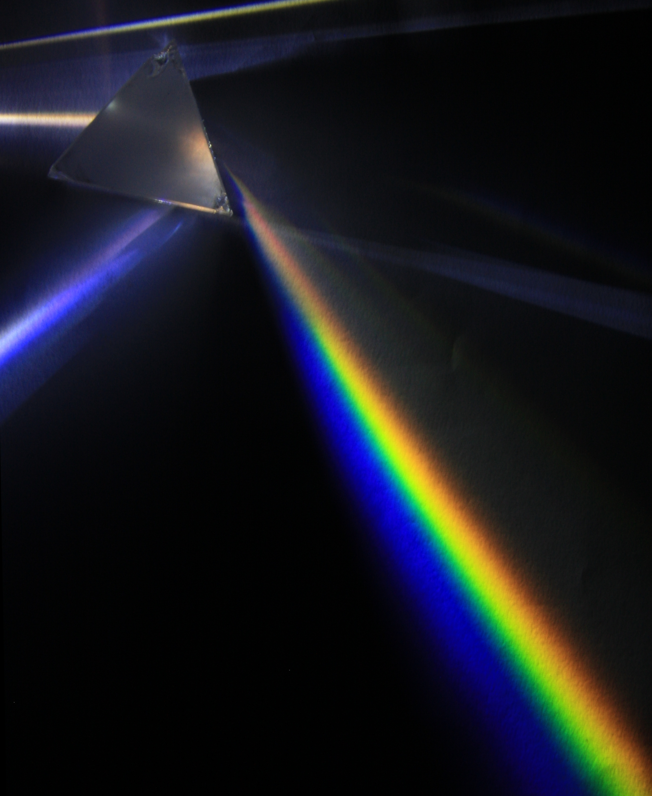 

2. Shine a red light through a second prism and observe the spectrum. 

Red light refracts to only red light, but at a different angle than (say) green light

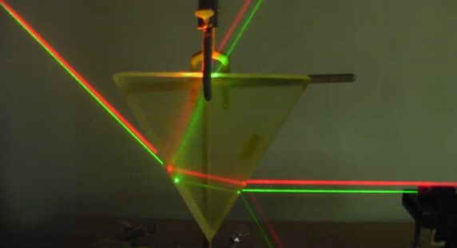 *Source: [The Wonders of Physics](https://wonders.physics.wisc.edu/lasers/)*

Conclusion: All the colors of the rainbow are mixed in white light

## Seeing light

Light emitted from the sun (or lamps) consists of many colors mixed together

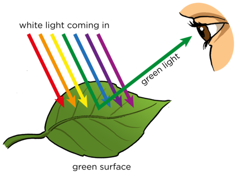

This leaf absorbs red and blue light
It reflects green light 

Our eyes absorb reflected green
light from the leaf, which triggers signals to our brains.

## Properties of Light

In the 17th and 18th centuries, scientists measured many properties of light, like its speed and energy.

Some experiments suggested that light was composed of little particles while others suggested that light travels in the form of waves. (Lots of debate!)

In the 19th and 20th Century, we were able to determine that light (all electromagnetic radiation) behaves like both a wave AND a particle.

## Color and Wavelength

The difference between colors is the wavelength of light.

##  Waves Examples

Wave on a rope

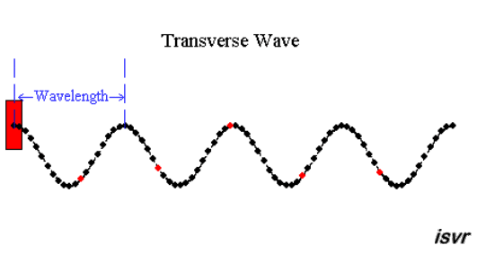

Water wave

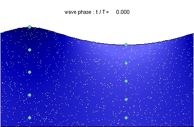

Sound wave

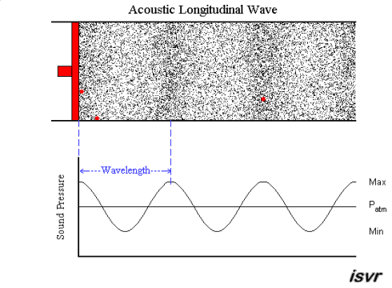

## Important wave characteristics:

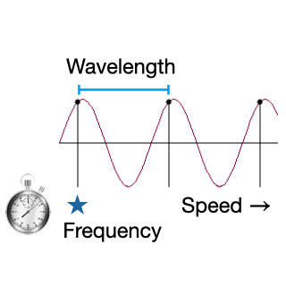

Wavelength (meters per cycle): distance between repeats

Frequency  (cycles per second): ups and downs at a single point

Speed (meters per second): the rate of travel

## Wave Speed Relationship
The speed a wave travels is given by

speed $=$ wavelength $\times$ frequency

At constant speed:

-  increasing the frequency decreases the wavelength
- decreasing the frequency increases the wavelength

## Light as a wave

Light is electromagnetic radiation, waves in electric and magnetic fields.

All light travels at the same speed: 300,000 km/s
the speed of light, c

Like sound or water waves, light is characterized by wavelength and frequency

The way light (all electromagnetic radiation) carries energy is different than other waves. It acts like particles.

## Particle and Wave properties

How do we know light has both?

Interference is a pattern made when waves overlap

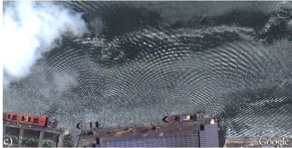

Light also makes these patterns. This is the famous "Double Slit" experiment where light is passed through two openings.

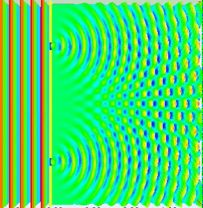

Water and air do not display interference if you have only a few molecules.

Light is different.  Interference patterns are built up by individual tiny “particles” of light: photons

<figure>
  <video controls width="100%">
    <source src="img/Wave-particle_duality.mp4" type="video/mp4">
    Your browser does not support the video tag.
  </video>
  <figcaption>
    An interference pattern is built up from many little dots.
  </figcaption>
</figure>

The wave nature and interference is built in to these component particles of light. This is called wave-particle duality.

## Photons and Energy

Light is made up of little particles called photons

Brighter light is more photons. 

What each photon can do depends on its frequency: 

Energy $=$ Planck’s constant $\times$ frequency

The higher the frequency, the higher the energy of each photon

### Example: Photoelectric effect

(Einstein got a Nobel Prize for this)

Light hits a metal surface

Radiative energy of light is converted to kinetic energy of electrons

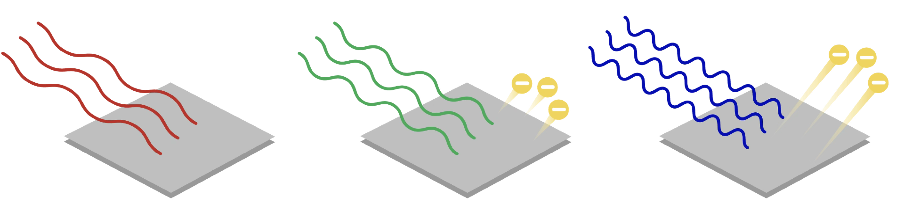

If the wavelength is too long, nothing happens. Long wavelength is low frequency. No photons have enough energy to kick out an electron.

## Check your understanding

Use these options for the next few questions

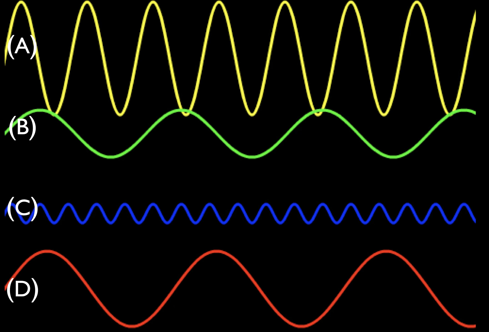

<quiz>
Which of these waves has the longest wavelength?

- [] A
- [] B
- [] C
- [x] D

</quiz>

<quiz>
If these waves are all traveling at the same speed, which has the highest frequency?

- [] A
- [] B
- [x] C
- [] D

</quiz>

<quiz>
Different colors of light have different wavelengths. The wavelengths are measured in nanometers.

Which wavelength of light has the highest energy?

- [x] 400 nanometers (violet)
- [] 500 nanometers (yellow)
- [] 600 nanometers (red)
- [] They all have the same energy

</quiz>