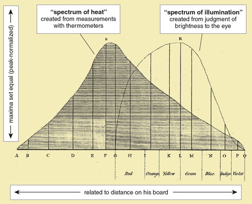

# Light

## Questions about Light

What is light?
How fast does it travel?
How much energy does it carry?
What different kinds are there?

## The speed of light

In 1676, Danish Astronomer Ole Römer made a systematic study of the exact timing of eclipses of Io, one of the moons of Jupiter
For several months the eclipses lagged behind the expected time, then they caught up again.

As the Earth and Jupiter orbit, the distance between them changes
Changes in light travel time cause observed lags
By the time Newton wrote the Principia, astronomers had confirmed that light traveled at a finite speed and “requires about seven or eight minutes to travel from the sun to the earth”

## Do prisms create rainbows, or reveal them?

In the 1660’s Isaac Newton tried the following experiment:

Shine white light through a prism and observe the resulting spectrum

Red light is a component of whte light

 

Shine a red light through a second prism and observe the spectrum. 

Red lights refracts to only red light, but at a different angle than green light

 *Source: [The Wonders of Physics](https://wonders.physics.wisc.edu/lasers/)*

Conclusion: All the colors of the rainbow are mixed in white light

## Seeing light

Light emitted from the sun (or lamps) consists of many colors mixed together

This leaf absorbs red and blue light
It reflects green light 

Our eyes absorb reflected green
light from the leaf, which triggers signals to our brains.

### Earthshine

We see the moon and planets in reflected light from the sun

We can see the darker part of a crescent moon from "Earthshine": sunlight light reflected from the Earth

*Source: [ESA](https://www.eso.org/public/italy/images/eso1210c/?lang)*

 

*Source: [American Scientist](https://www.americanscientist.org/article/herschel-and-the-puzzle-of-infrared)*

## Check your understanding