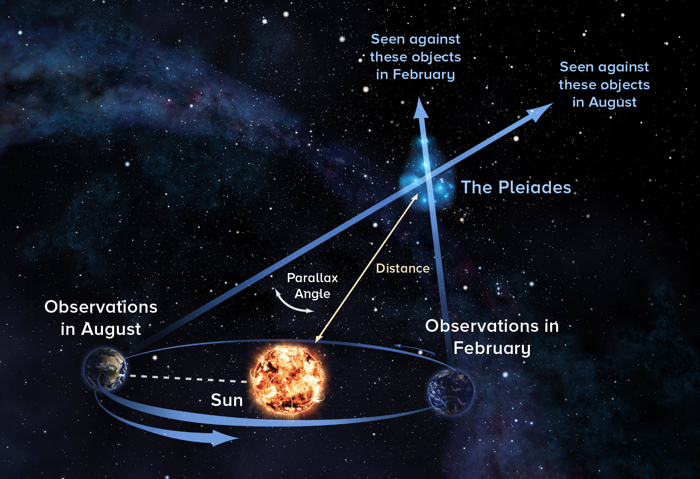
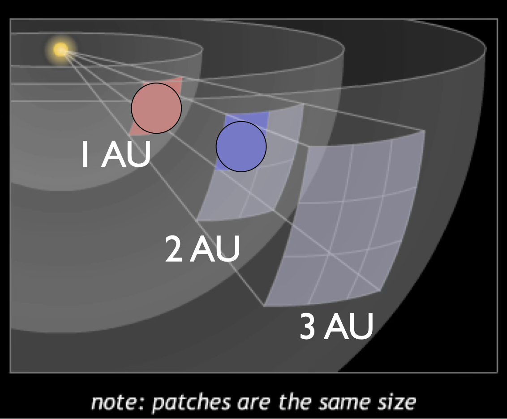

# Light and Distance

 *Source [Alexandra Angelich (NRAO/AUI/NSF)](https://public.nrao.edu/gallery/measuring-the-distance-to-the-pleiades-2/)*

## Check your understanding

<quiz>

Alpha Centauri is the third brightest star in the night sky, and looks yellow like our Sun.
Arcturus is the fourth brightest star in the night sky, and looks orange.

Based on this information, which star has a greater luminosity?

- [] Alpha Centauri
- [] Arcturus 
- [] They have the same luminosity
- [x] Can't tell from this information 

Alpha Centauri has about twice the luminosity of our Sun. Arcturus has about 25 times the luminosity of our Sun.

To figure this out from brightness, you also need to know distance.

</quiz>

<quiz>
There are two planets, each the same size, at two different distances from a star.

The planet at 1 AU collects 4 units of energy.

How much energy is collected by the planet at 2 AU?

- [x]  1/4 units
- []   1 unit 
- []  4 units
- []   16 units
</quiz>

<quiz>
Two stars have the same energy output.
Star A is 10 Parsecs away.
Star B is 20 Parsecs away.

Which looks brighter in the sky?

- [x]  Star A appears brighter
- [] Star B appear brighter
- []  They have the same brightness

B is twice the distance, so our eyes collect a quarter the amount of energy from B.

</quiz>