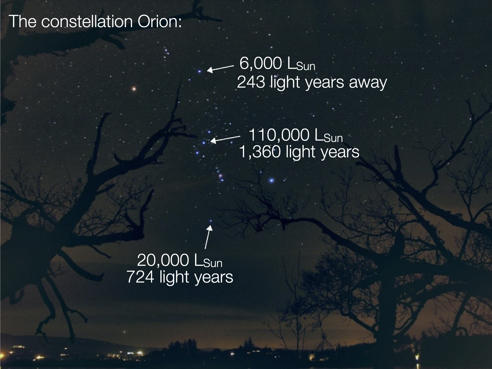
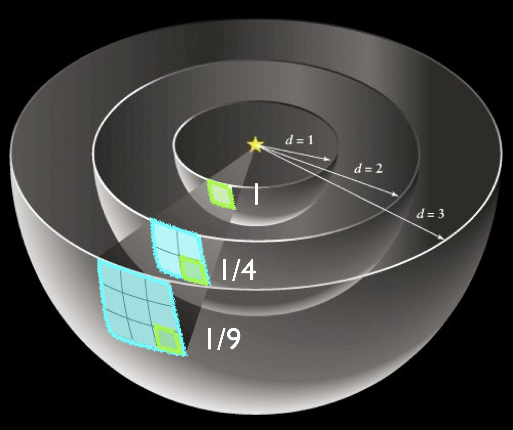
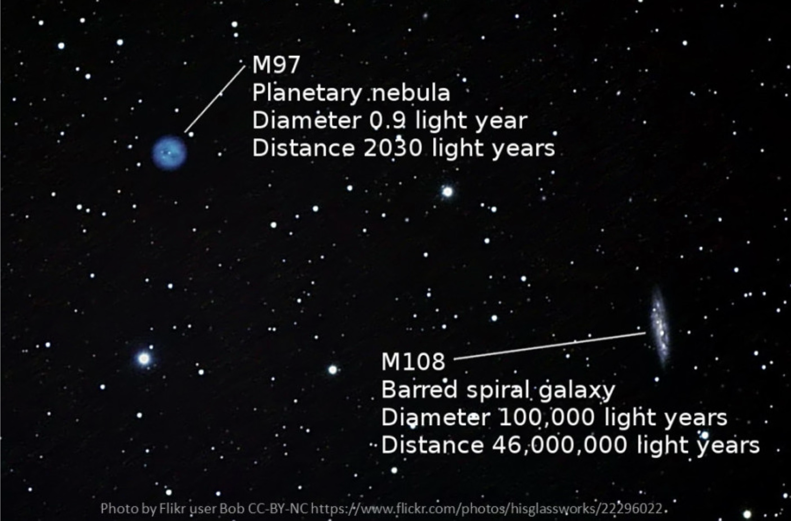
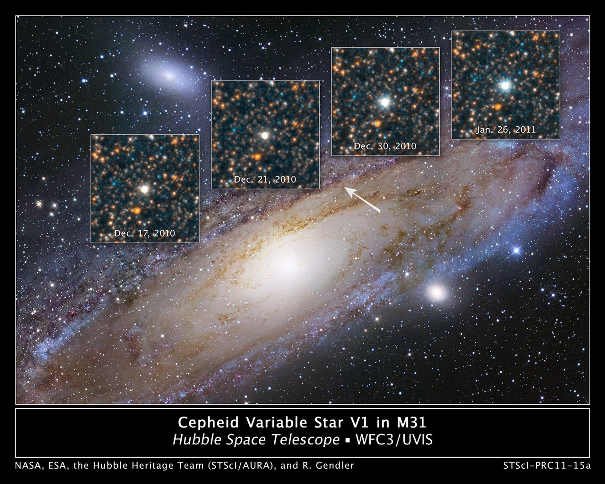

# Light and Distance

- Luminosity, Distance, and Brightness
- Standard Candles
- Cepheid variables and stars beyond the Milky Way

## Observing Stars

Vega (brightest star in Lyra, appears as the 2nd brightest star in the sky)

Antares (brightest star in Scorpius, appears as the 16th brightest star in the sky)

Which is more luminous?

|  | Vega | Antares |
|----------|------|---------|
| Surface Area | 5.8 ASun | **780,000 ASun**|
| Temperature (Sun is 5800 K) | **9600 K** | 3400 K |
| Luminosity | 40 LSun | **57,500 LSun** |
| Distance | **25 light years** | 550 light years |
| Apparent brightness |**2nd brightest in sky** | 16th brightest in sky |

How bright a star looks depends on distance.

A star’s luminosity is how bright the star is in an absolute sense, the total amount of power that star emits

A star’s apparent brightness is how bright that star is to us, here on Earth

More distant stars will appear less bright

## How distance changes brightness

The energy in light is spread out over a larger and larger area as it moves away from the star

A fixed amount of light spreads over increasing area (blue)

an eye, telescope, camera, or planet collects light in a fixed area (green)

## Energy and distance

brightness 
(energy collected per unit area)

energy output  (luminosity)

distance 

$\text{Brightness} =\frac{\text{Luminosity}}{4 \pi \text{Distance}^2}$

$4 \pi \text{Distance}^2$ is the area the energy is spread out over

## GAIA and distance

Remember parallax:
 *Source [Alexandra Angelich (NRAO/AUI/NSF)](https://public.nrao.edu/gallery/measuring-the-distance-to-the-pleiades-2/)*

For 1.7 billion nearby stars we can measure: 
- temperature, apparent brightness
- parallax distance

then calculate
- luminosity (from brightness and distance)
- size (from temperature and luminosity)

If we know luminosity and measure brightness, we can determine distance.

But stars vary hugely in energy output, depending on their size and temperature!

## Standard Candles

Standard Candles 
are astronomical objects with known energy output

When we record their brightness, we can calculate how far away they are

$\text{Brightness} =\frac{\text{Luminosity}}{4 \pi \text{Distance}^2}$

## Cepheids

In 1908, Henrietta Leavitt discovered the energy output of stars called Cepheid variables could be determined from their periodic brightness variation.

## Cepheids in Andromeda

In the early 1900s, most astronomers considered the Milky Way a single "island universe" of stars

Other galaxies, like Andromeda, were cataloged as fuzzy patches of light called “spiral nebulae.” 

 

Edwin Hubble measured Cepheids in nearby galaxies and showed that our Universe extends beyond the Milky Way

 *Source [NASA, ESA, Hubble Heritage Project, Robert Gendler](https://science.nasa.gov/asset/hubble/cepheid-variable-star-v1-in-andromeda-galaxy/)*

## Check your understanding

<quiz>

Alpha Centauri is the third brightest star in the night sky, and looks yellow like our Sun.
Arcturus is the fourth brightest star in the night sky, and looks orange.

Based on this information, which star has a greater luminosity?

- [] Alpha Centauri
- [] Arcturus 
- [] They have the same luminosity
- [x] Can't tell from this information 

Alpha Centauri has about twice the luminosity of our Sun. Arcturus has about 25 times the luminosity of our Sun.

To figure this out from brightness, you also need to know distance.

</quiz>

<quiz>
There are two planets, each the same size, at two different distances from a star.

The planet at 1 AU collects 4 units of energy.

How much energy is collected by the planet at 2 AU?

- [x]  1/4 units
- []   1 unit 
- []  4 units
- []   16 units
</quiz>

<quiz>
Two stars have the same energy output.
Star A is 10 Parsecs away.
Star B is 20 Parsecs away.

Which looks brighter in the sky?

- [x]  Star A appears brighter
- [] Star B appear brighter
- []  They have the same brightness

B is twice the distance, so our eyes collect a quarter the amount of energy from B.

</quiz>