# Plotting Spectra

- Plotting thermal spectra
- Plotting absorption/emission
- The composition of gas, rocks, and stars
- Exoplanet atmospheres

## Plotting Spectra

![Picture and graph of a spectrum stacked vertically. Picture of a Spectrum (top): Rectangle with rainbow coloring from blue at left to red at right. Rainbow broken up with vertical black lines of varying width. Graph of a Spectrum (bottom): Brightness on y-axis increases from bottom to top. Callout reads, “Brightness (might be labeled as intensity, counts, flux, power, absorbance, transmittance, or reflectance).” Wavelength in nanometers on x-axis ranges from 400 to 700. Callout reads, “Color (often labeled as wavelength, but can also be labeled as energy or frequency).” Data graphed as line with area below line colored to match the blue to red of picture above. Line has many narrow valleys that correspond to the dark lines in the picture. Three valleys labeled “Hydrogen.”  Arrow pointing to “Hydrogen” label reads, “Astronomer’s Interpretation: Peaks and valleys are labeled with the elements and compounds that caused them.”](img/content_PictureGraphSpectrum.jpg)
*Source: [NASA, ESA, and L. Hustak (STScI)](https://science.nasa.gov/mission/webb/science-overview/science-explainers/spectroscopy-101-types-of-spectra-and-spectroscopy/)*

## Thermal Spectra

A hotter object emits light with higher (average) energy
➡︎ Peak wavelength is shorter ➡︎ More blue in color

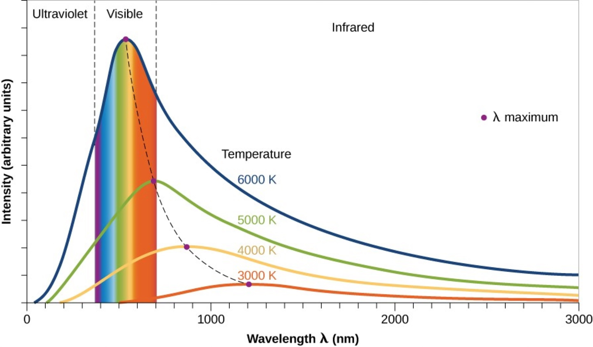

### Comparing thermal spectra
A hotter object emits more intensity at every wavelength,  AND the peak wavelength changes

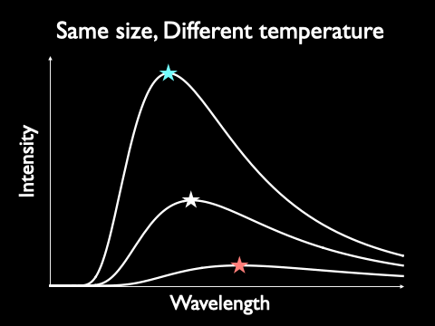

A larger object will emit more intensity at every wavelength, but size doesn’t change the peak wavelength 

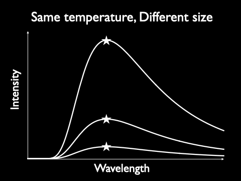

## Plotting the Three Types of Spectra

![Infographic showing the relationship between the continuous spectrum of a star whose light is shining on gas, the emission spectrum of glowing gas, and the absorption spectrum of that gas. The graphic is divided into two parts. The top half shows a light source with a light wave passing into, through, and out of a cloud of gas. The bottom half shows the three types of spectra in picture and graph forms. From left to right: “Continuous Spectrum” is shown as a continuous rainbow and a smooth hump-shaped line on a graph of brightness versus wavelength; “Emission Spectrum” is shown as a series of thin colored lines separated by black spaces, and a series of sharp peaks on a graph of brightness versus wavelength; and “Absorption Spectrum” is shown as a rainbow with a series of thin black lines replacing some of the colors, and a smooth curve with a series of sharp valleys on a graph of brightness versus wavelength.](img/content_STScI-J-article-Spectroscopy-Part3-DifferentSpectra-f-1600x872.jpg)*Source: [NASA, ESA, and L. Hustak (STScI)](https://science.nasa.gov/mission/webb/science-overview/science-explainers/spectroscopy-101-types-of-spectra-and-spectroscopy/)*

## Plotting Emission

“Fingerprint” of composition, emitted by energized gas

Hydrogen:

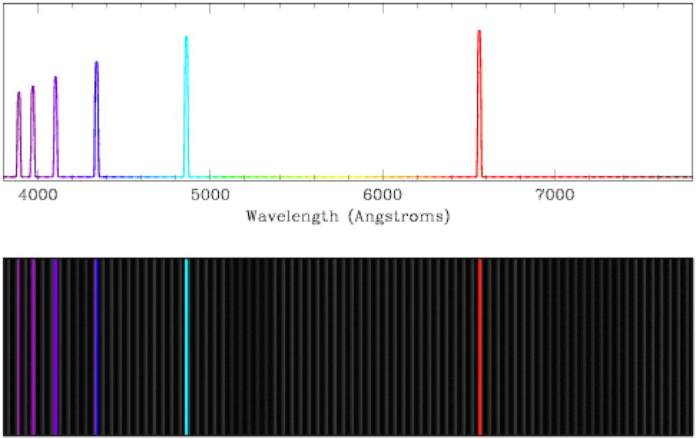
### Orion nebula

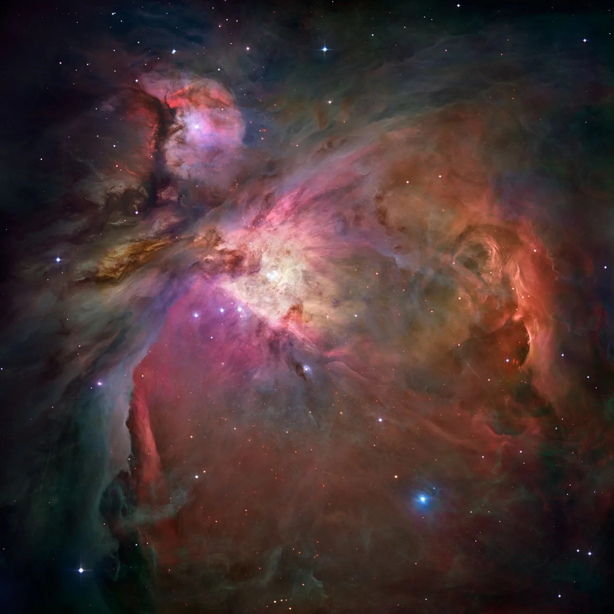*Source: [NASA, ESA, M. Robberto (Space Telescope Science Institute/ESA) and the Hubble Space Telescope Orion Treasury Project Team](https://science.nasa.gov/mission/hubble/science/explore-the-night-sky/hubble-messier-catalog/messier-42/)*

Orion Nebula:
Hydrogen, oxygen, helium…

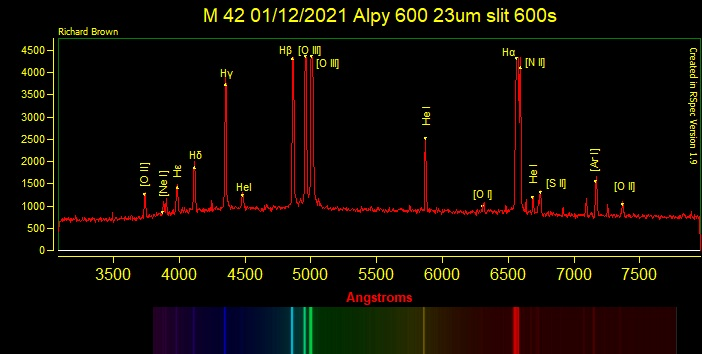 *Source [Richard Brown](https://www.cloudynights.com/forums/topic/750583-spectral-profiles-of-m42-v1150-tau-and-psi-per/)*

### Mars

The Curiosity Rover is exploring the surface of Mars
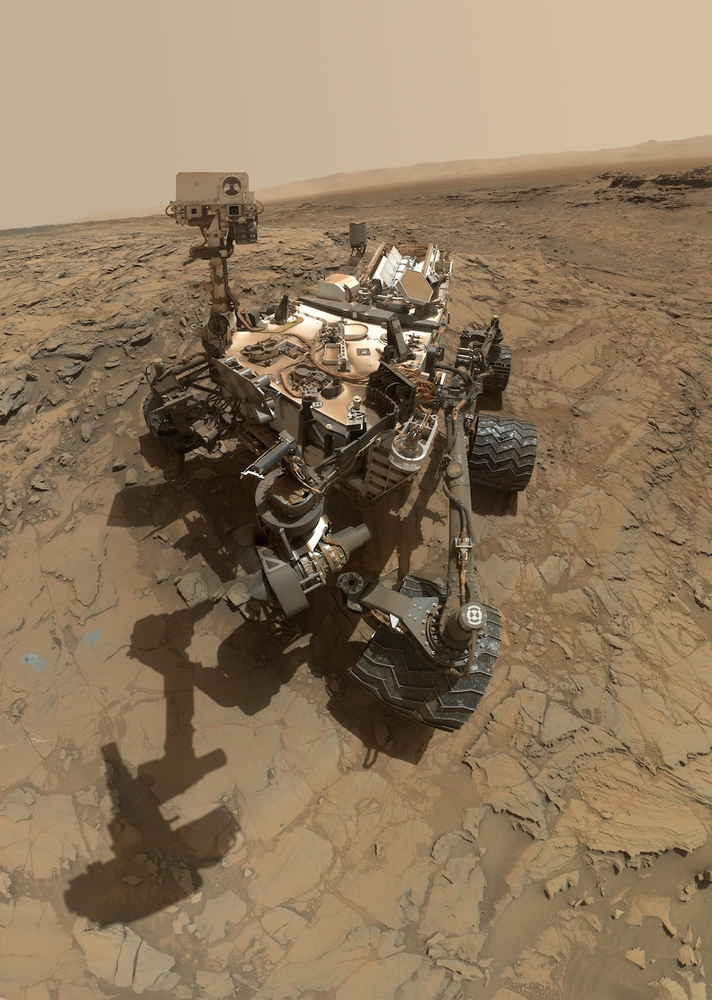 *Source [NASA/JPL-Caltech/MSSS](https://science.nasa.gov/photojournal/curiosity-self-portrait-at-big-sky-drilling-site/)*

Curiosity uses a lazer to vaporize a little bit of martian rocks

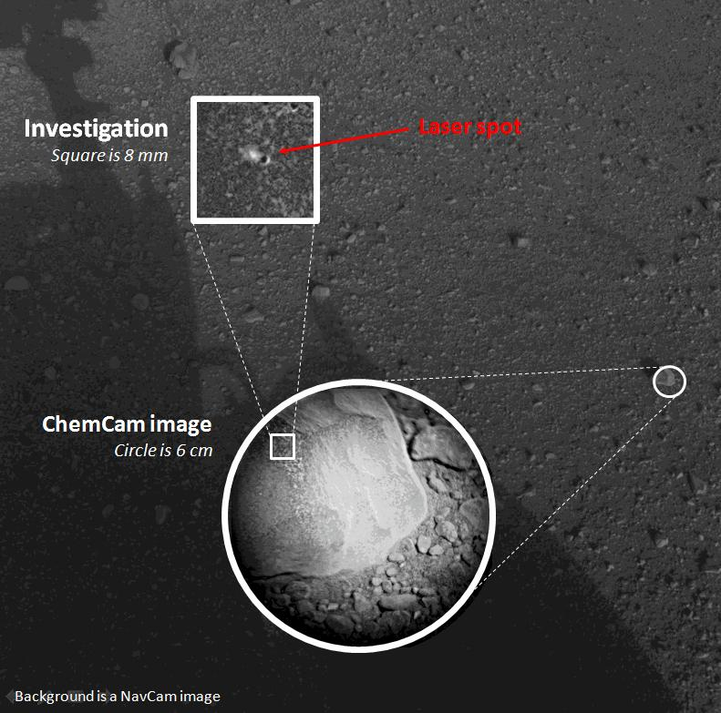 *Source[NASA/JPL-Caltech/LANL/CNES/IRAP](https://science.nasa.gov/photojournal/first-laser-zapped-rock-on-mars/)*

The spectrum tells us about the composition of rocks on Mars

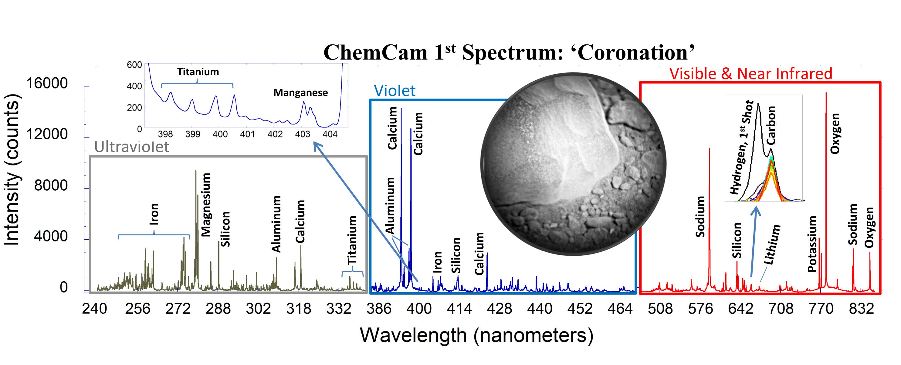 *Source [NASA/JPL-Caltech/LANL/CNES/IRAP](https://science.nasa.gov/resource/coronations-chemicals/)*

## Plotting spectra: absorption

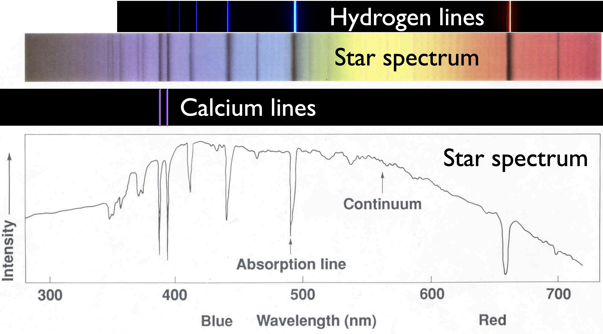

### Different stars, different absorption

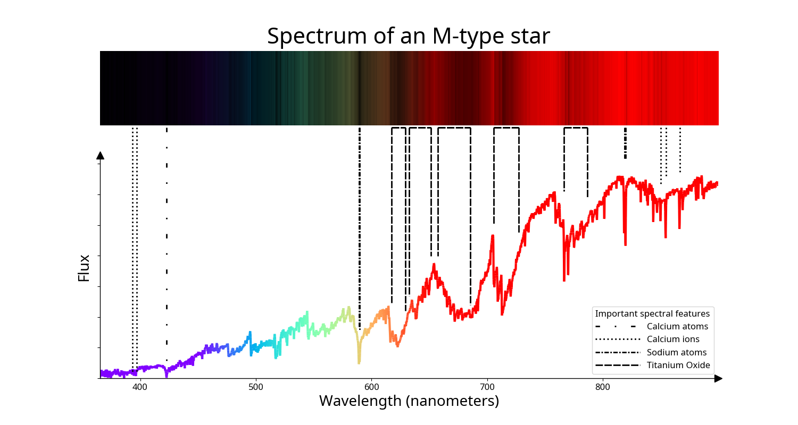

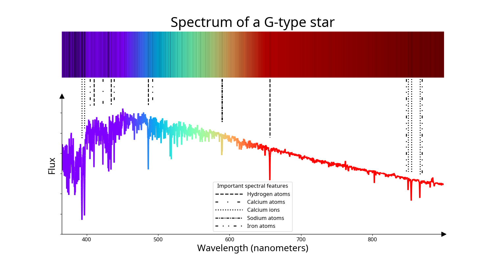

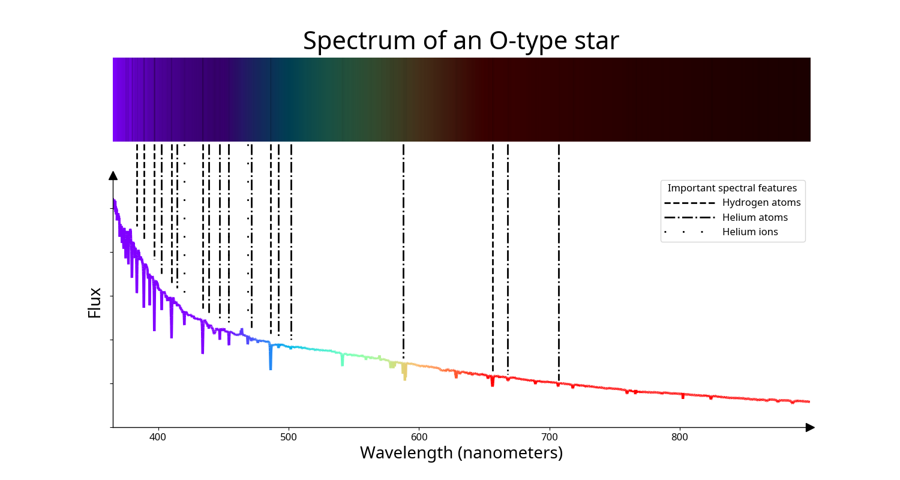

*Source [IAU Office of Astronomy for Education](https://astro4edu.org/resources/glossary/term/328/)*

## The Composition of Stars

Meghnad Saha (1893-1956)

Showed how absorption lines depend on temperature and pressure

Cecelia Payne-Gaposchkin 
(1900-1979) 

Used spectral lines under different conditions determine the composition of the sun and stars.

The sun is 
71% hydrogen, 
27% helium, 
and less than 2% all other elements.

“The fact that so many stars have identical spectra is in itself a fact suggesting uniformity of composition; and the success of the theory of thermal ionization in predicting the spectral changes that occur from class to class is a further indication in the same direction.”
Stellar Atmospheres, Cecilia Payne-Gaposchkin, 1925

All stars are mostly hydrogen and helium!

## Exoplanets

.gif)

Reflection from surface

Transmission through atmosphere

Planet Phases allow measure of reflected light, temperature.
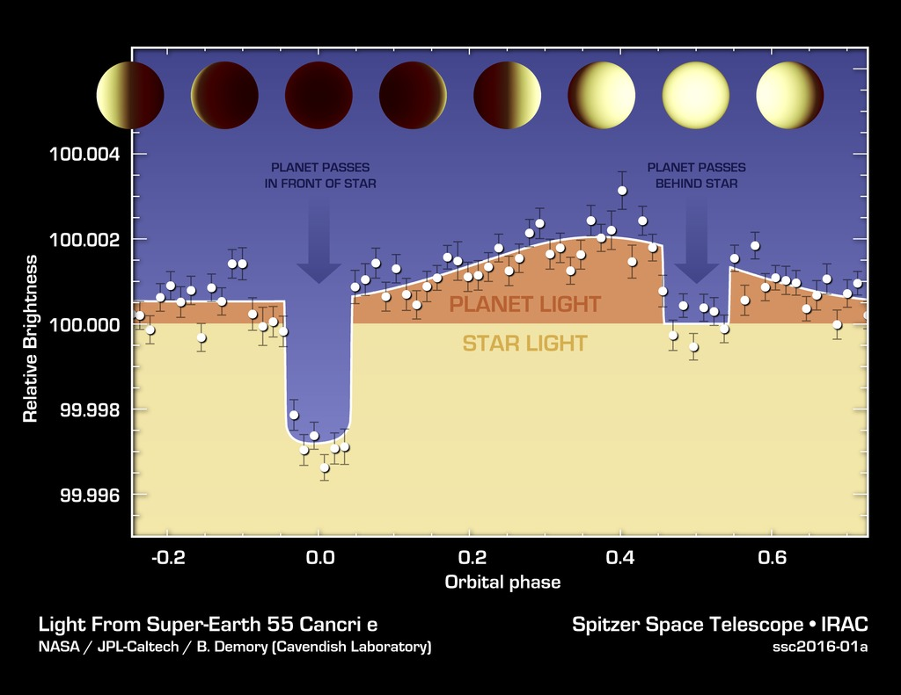
*Source [Spitzer](https://www.spitzer.caltech.edu/image/ssc2016-01a-hot-n-hotter-planet-measured-by-spitzer)*

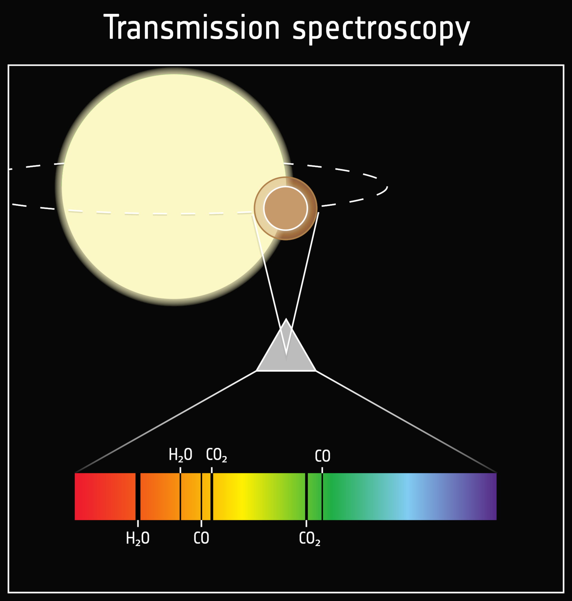

Atmosphere composition of an exoplanet: how much light does the atmosphere block?
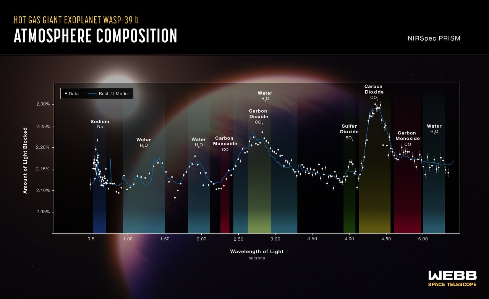 *Source [NASA, ESA, CSA, J. Olmsted (STScI)](https://esawebb.org/images/weic2221f/)*

## Check your understanding

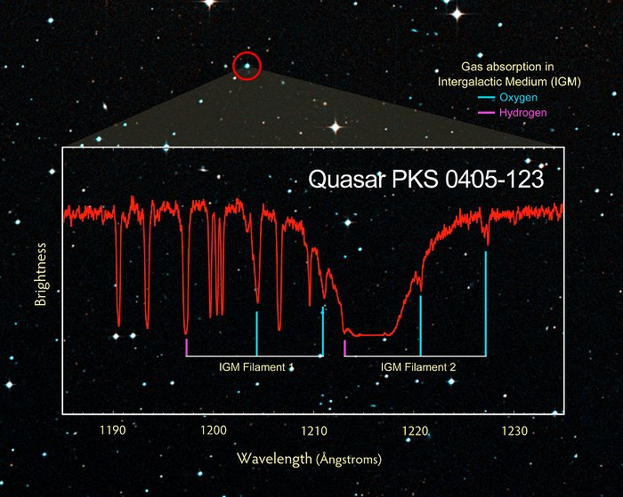
<quiz>
What type of spectrum is shown in the plot above, from Quasar PKS 0405-123?

- [] Emission
- [x] Absorption
- [] Continuous

</quiz>

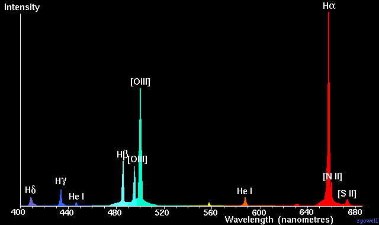
<quiz>
What type of spectrum is shown in the plot above, from NGC 3372 (the Eta Carinae Nebula)?

- [x] Emission
- [] Absorption
- [] Continuous

</quiz>