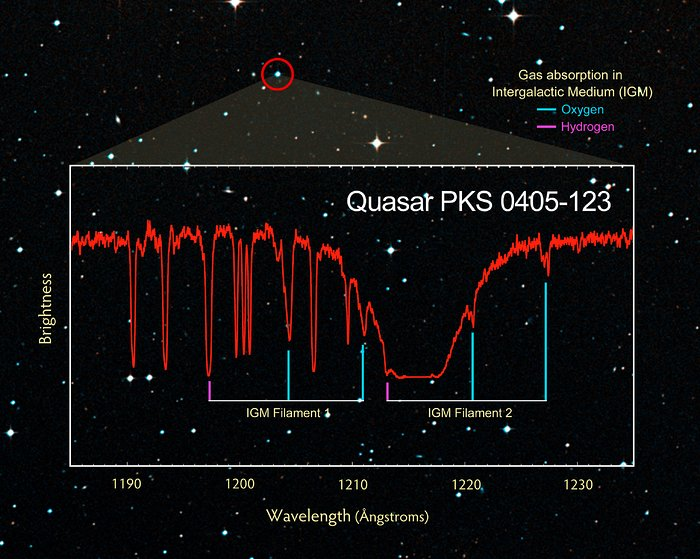
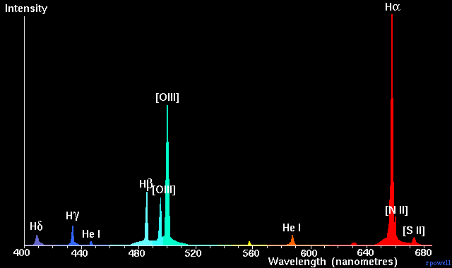

# Plotting Spectra

## Thermal Spectra

## Check your understanding

<quiz>
What type of spectrum is shown in the plot above, from Quasar PKS 0405-123?

- [] Emission
- [x] Absorption
- [] Continuous

</quiz>

<quiz>
What type of spectrum is shown in the plot above, from NGC 3372 (the Eta Carinae Nebula)?

- [x] Emission
- [] Absorption
- [] Continuous

</quiz>