# Spectra

- The story of light
- Different types of spectra
- How light is produced
- Emission and absorption in atoms

## Spectra

A prism or diffraction grating bends light differently depending on wavelength.

The resulting  spectrum tells you how much light is emitted at each wavelength.

Light carries a story of its emission and its path to us (the observers)

### Earthshine

We see the moon and planets in reflected light from the sun

We can see the darker part of a crescent moon from "Earthshine": sunlight light reflected from the Earth

*Source: [ESA](https://www.eso.org/public/italy/images/eso1210c/?lang)*

## Spectra and the source of light

A hot, dense object emits a continuous range of wavelengths

Heated (or electrified) gas emits only a few wavelengths

A cooler gas can absorb some wavelengths from a continuous spectrum

## Spectrum demonstration

  <iframe
    src="https://www.youtube.com/embed/oae5fa-f0S0?start=74"
    style="position:absolute;top:0;left:0;width:100%;height:100%;"
    title="YouTube video"
    frameborder="0"
    allow="accelerometer; autoplay; clipboard-write; encrypted-media; gyroscope; picture-in-picture; fullscreen"
    allowfullscreen>
  </iframe>

Different light sources have different spectra.

Incandescent Lamp

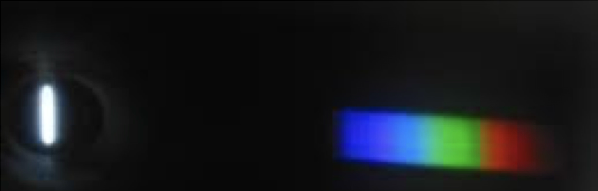

Hydrogen gas tube
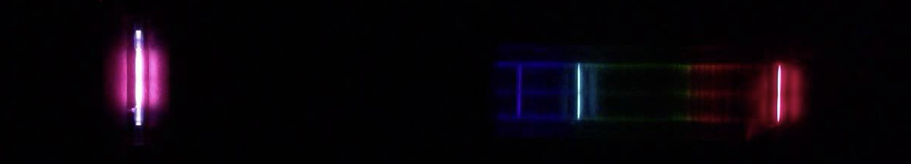

Complicated spectra can come from a combination of basic types.

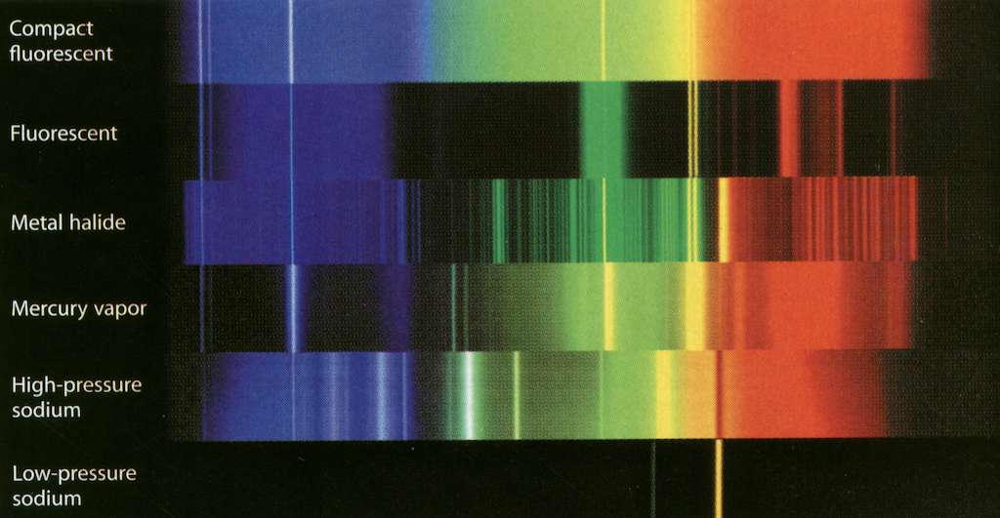

## Classification of Spectra

Continuous spectrum, emission spectrum, and absorption spectrum
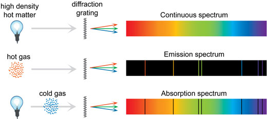

What's with the lines in the emission spectra?

## How light is Produced

Light is emitted by atoms

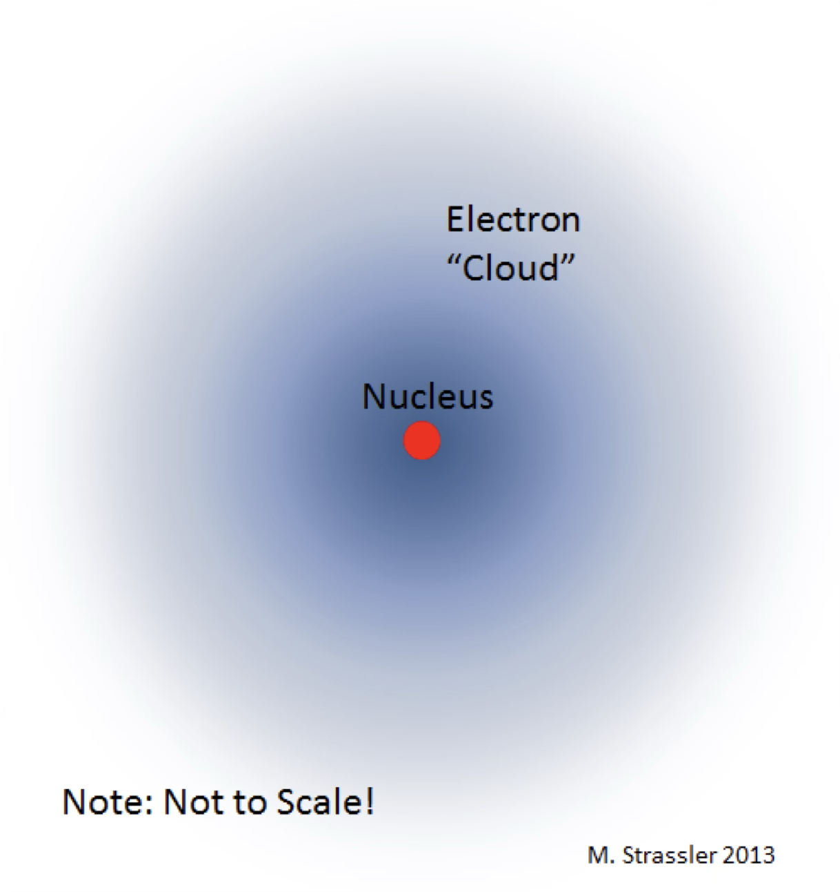

Each atom has electrons around its nucleus

The electrons have potential and kinetic energy that can be converted into radiative energy

Quantum physics says that only some electron energies are allowed (orbitals)

## Electron energies

(schematic diagram)

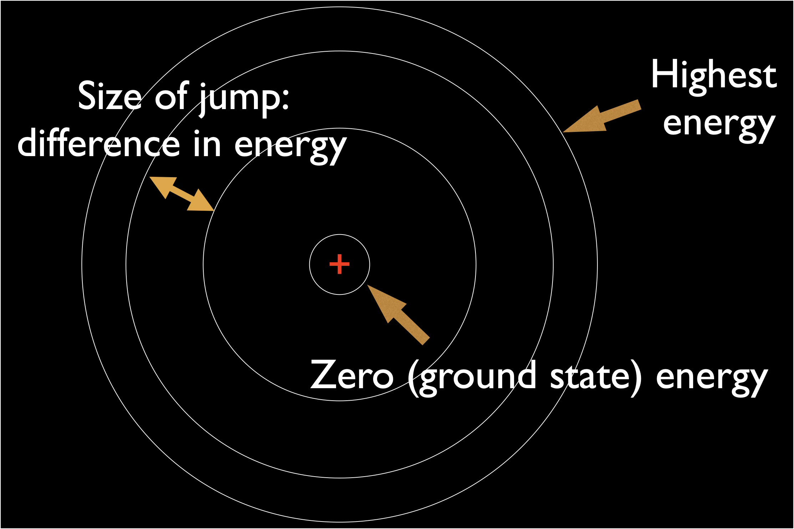

An electron has more energy when it is (on average) farther from the nucleus

## Emission sources

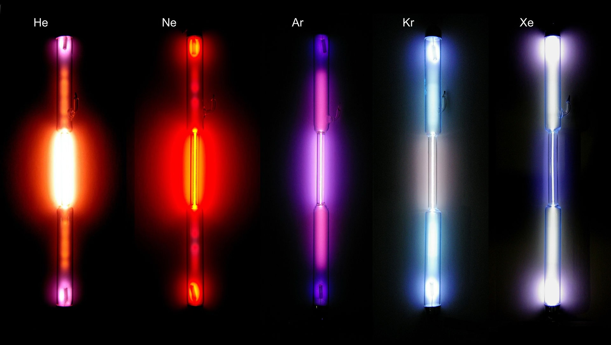

Heat, electric fields, or absorbed light can give an electron the right amount of energy to move to a higher energy level

Electrons return to lower energy levels by emitting light at specific wavelengths

Note: Energy is conserved!

## Example: Hydrogen

Absorbing energy

Only with the right match does the electron move up, unless the energy is high enough to kick it off completely.

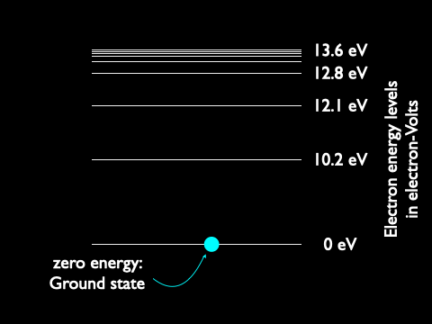

Releasing energy

Each energy step makes a particular color.

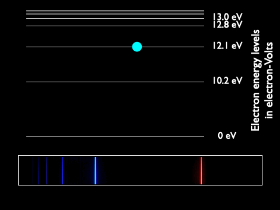

## Absorption Spectra

Absorption and emission are connected

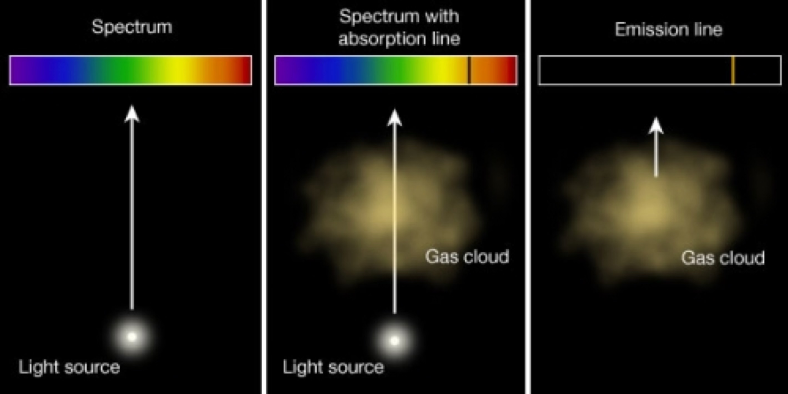

The lines in absorption spectra are caused by scattering: electrons absorbing a photon and then emitting it in random directions

The dark lines are at the same wavelengths as emission spectra from the same gas

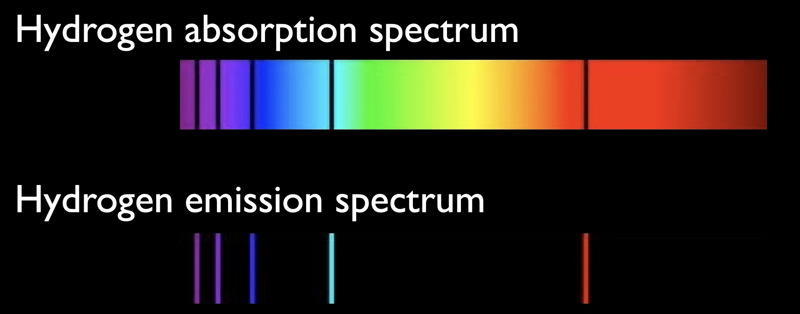

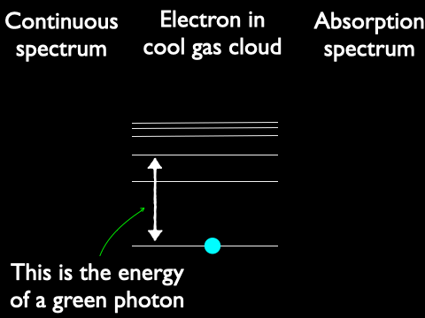

## Summary of spectral types

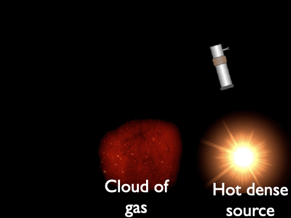

## High resolution spectrum of the Sun

This is an absorption spectum!

## Check your understanding
<quiz>

The electron now has \_\_\_\_\_\_\_\_ energy and has \_\_\_\_\_\_\_\_ light in the process

- [] less, emitted
- [] less, absorbed
- [] more, emitted
- [x] more, absorbed
</quiz>

<quiz>

The electron now has \_\_\_\_\_\_\_\_ energy and has \_\_\_\_\_\_\_\_ light in the process

- [x] less, emitted
- [] less, absorbed
- [] more, emitted
- [] more, absorbed
</quiz>

Use this image for the next two questions:

<quiz>
Which atom would be
emitting light with the
greatest energy?

- [] A
- [] B
- [x] C
- [] D
</quiz>

<quiz>

The element illustrated is is producing  violet, green, yellow and red emission lines.

Which electron emits red light?

- [x] A
- [] B
- [] C
- [] D
</quiz>
